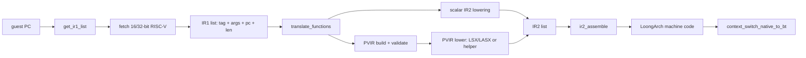

# LATR: RISC-V RV64GC → LoongArch 翻译器（设计与实现）

状态：**RV64IMAFDC + Zba/Zbb/Zbs/Zicbo + Zicsr/特权/M/S/U + Sv39/48/57 + Sstc/PLIC/SBI 子集 + HPM/stateen 存储子集 + RVV 子集** 已可执行并通过 QEMU-LoongArch 裸机套件、QEMU-RISC-V golden 差分与系统级差分（本轮实测：`make test-latr` → `latr-isa: PASS checks=1201`、`latr-riscv-ref: PASS`、`latr-diff: PASS`；`make latr-sys-diff` → qemu/latr SYS 行逐字节相同；`make -C latr test-decode` → `LATR decode: 26 checks passed`）。仍是**研究原型**：尚无 VMM 内的 RISC-V machine/CPU loop，RVV 全指令集与矢量 golden 差分、真实 HPM 事件后端、AIA/IMSIC/APLIC 与 virtio/PCI 机器仍缺。
范围：`riscv64` little-endian；RVV 已实现整数/浮点子集（VLEN=128、ELEN=64，`misa.V` 已置位），但尚未覆盖全部 RVV 1.0 指令。
设计中不处理：RV32、big-endian、H 扩展、加密扩展、RV128。

## 0. 证据基准

| 角色 | 来源 |
| --- | --- |
| RISC-V 语义金标准 | `../QEMU-LVZ`（QEMU 9.0.50；`git log -- target/riscv` 只有初始导入 `fc0726f`，`git diff HEAD -- target/riscv` 为空，RISC-V path 确实未被该 fork 修改） |
| RISC-V 编码表 | `../QEMU-LVZ/target/riscv/insn32.decode`、`insn16.decode`；RVV 段在 `insn32.decode:350-737` |
| RVV 执行语义 | `../QEMU-LVZ/target/riscv/vector_helper.c`、`vector_internals.h`、`insn_trans/trans_rvv.c.inc` |
| RISC-V 浮点/NaN-box | `../QEMU-LVZ/target/riscv/fpu_helper.c:27-55`、`internals.h:87-104` |
| LBT 语义/编码 | [Unofficial LoongArch Intrinsics Guide: LBT Basics](https://jia.je/unofficial-loongarch-intrinsics-guide/lbt_basics/)、`../QEMU-LVZ/target/loongarch/tcg/insn_trans/trans_lbt.c.inc`、`tcg/op_helper.c` |
| LVZ 语义 | `../QEMU-LVZ/README.md`、`target/loongarch/cpu-csr.h:215-260`、`tcg/tlb_helper.c:721-966` |
| 指令编码 | Homebrew LLVM 23.1.6：`$(brew --prefix llvm)/bin/llvm-mc -triple=riscv64 -mattr=+v`；已验证 `vadd.vv v4,v2,v1,v0.t` → `[0x57,0x82,0x20,0x00]`、`addw a0,a1,a2` → `[0x3b,0x85,0xc5,0x00]` |
| 现有转译结构 | `target/arm/lata/`、`lata/Makefile`、`lata/lata_externals.allowlist` |
| PVIR 核心 | `target/arm/lata/include/la-pvir.h`、`target/arm/lata/pvir.c`、`tests/test_pvir.c` |
| 现有 TB 缓存/页表 | `include/loongemu/tb_cache.h`、`include/loongemu/arm64_paging.h`、`src/arm64_paging.c` |

本文中的 `../QEMU-LVZ` 均相对于仓库根目录 `loongemu/`；`target/...`、`lata/...` 等也相对于仓库根目录。

### 0.1 已核对的现状（避免把计划当成已实现）

- **PVIR 核心/API 已实现并通过主机测试**：`make test-pvir` → `PVIR: 222 checks passed`（本轮实测）。
- **PVIR 尚未接入 IR1→IR2**：`target/arm/lata/translator/translate-a64.c` 没有引用 `la-pvir.h`；`translate_functions[]` 只登记了 `AARCH64_A64_SVE_FEATURE_ABSENT`，`AARCH64_A64_SVE_ACCESS_UNSUPPORTED` 为 `NULL`；PTRUE/ADD/LD1B 等 SVE IR1 tag 没有 lowerer（`translate-a64.c:17023-17153`、`ir1.h:148-151`）。
- **SVE 前端是半成品**：`a64_sve_decode()` 只覆盖代表性子集，且 `translate_functions` 对 SVE allowed 路径没有翻译函数；因此不能把 SVE 的现状当成 RVV 的可复用实现。
- **LATA 的路径是完整的**：`get_ir1_list()`（`translate-a64.c:17329`）→ `translate_aarch64_insn()`（`:17454`）→ `tr_ir2_generate()`（`:17547`）→ `ir2_assemble()`/`tr_ir2_assemble()`（`ir2-assemble.c`、`lata.c:600`）。
- **LBT 的 IR2 落点已存在**：`la-append.h` 已声明 `la_rotr_*`、`la_rotri_*`、`la_jiscr0/1`、`la_gr2scr/scr2gr`、`la_addu12i_*`；LATA 自身没有使用 `jiscr0`，LATX 在 `latx/translator/translate.c:3000-3030` 使用。
- **`test-sve-decode` 在本机主机链接失败**（`Undefined symbols: _stderr`），这是当前工作树的既有问题，与本设计无关；本文不据此声称 LATA 全套测试通过。
- **LATR 本轮实测通过**：`make test-latr` → `latr-isa: PASS checks=1337`（RV64I/M/A、RVC、F/D 含 RMM、Zba/Zbb/Zbs、CSR/HPM/mstateen、MRET/SRET/WFI/SFENCE.VMA、CBO.ZERO、陷阱、LR/SC、AMO、PMP、跨页/RVV/PVIR 统一访存、软件 TLB、PLIC 双 context）、`latr-riscv-ref: PASS`、`latr-diff: PASS`（12 字段签名逐位相同）；`make -C latr test-decode` → 26 checks；`make latr-sys-diff` → QEMU-RISC-V 与 LATR system board 的 SYS 行逐字节相同。
- **`CPUArchState` 偏移陷阱（本轮踩到）**：只有 `pc(512)/fcsr(520)/exception(528)/badaddr(536)` 落在 `la_ld/st_d` 的 ±2 KiB 立即数范围内；`privilege(33312)`、`csr[](544+)`、`reservation_*(33344+)`、`host_return_address` 一律必须走 `latr_env_load_d/latr_env_store_d`（内部用 `r21` 拼大偏移）。直接 `la_st_d(..., env_ir2_opnd, env_offset_reservation_valid())` 会触发 `la-append.c:3573` 的 `imm_si12 <= 0xfff` 断言，在裸机里表现为 UART 打印断言后死循环（宿主 QEMU 被超时杀掉，很容易误判成“guest 卡死”）。
- **LATR 已确认的语义决定（都有测试钉住）**：
  - **CSR 立即数**：QEMU 把 `csrrwi/si/ci` 的 uimm 解码进 `arg.rs1`，没有独立立即数字段；此前遗留的 `zimm` 字段恒为 0，曾把 `csrrwi frm,4` 写成 0（连带 dynamic-RMM 与保留舍入模式用例失败）。`zimm` 已删除。
  - **非法指令**：解码失败不再让 TB 翻译返回 `false`，而是把该指令计入 TB（`tr_ir2_generate()`/`target_disasm()` 同口径截断），在 IR2 里经 `latr_raise_illegal_instruction()` 投递（`mcause=2`、`mtval=指令字`、`mepc=该 PC`、`pc=mtvec`）；FP 的非法路径也改走同一投递，不再自写 `badaddr=0`。
  - **FENCE**：与 QEMU `trans_fence()` 一致，**任意 `fm` 都按全屏障执行**，不按规范把保留 `fm` 判非法；golden 优先于规范的严格化。
  - **LR/SC**：预约以 `reservation_{addr,size,epoch,valid}` 表示，SC 时与全局写 epoch 比较；**任何 guest 写都保守地使预约失效**（规范允许 SC 伪失败），SC 的实际读改写由 LoongArch `ll/sc` 完成。LA `sc` 成功返回 1，RISC-V 成功返回 0。全局存储锁的 `sc` 失败原先会继续往下走，现已重试（`la_beq(status, zero, retry)`）。
  - **原子访问的自然对齐与陷阱清预约**：`lr/`sc/AMO 在做任何访存或取锁之前先检查 `addr & (size-1)`，非对齐按 cause 4（load）/6（store-AMO）投递，`mtval=地址`、`mepc=该指令`——避免把非对齐地址交给宿主 `ll/sc` 而触发宿主 ADE。`transfer_exception()` 在写 `mcause/mtval` 后立即清 `reservation_valid`：任何陷阱（含 `ecall`、页故障、非法指令）都会丢弃预约，陷阱处理程序与上下文切换不会继承它。**仍开放的边界**：直接映射模型下没有 MMIO 区可排除，也没有多核失效广播；`SC` 对 MMIO 的语义与跨核 `SFENCE.VMA/FENCE.I` 拍击属于 Phase 2/3（见 §3.5、§8）。
  - **host 调用**：`emit_runtime_call()` 的调用目标必须走 `ra_alloc_itemp()`（此前直接用 `la_s0`，与分配器状态不一致）。
  - **构建头文件顺序**：LATR 与 LATA 一样，QEMU 头由 `latx/compat` 的免费宿主 shim 解析；仓库根的 `include/` 是**不完整**的（`include/qemu/osdep.h`、`include/exec/tb-context.h` 都不存在）。`latr/Makefile` 的 `INCS` 因此把 compat 目录放在 `-I../include` 之前，仅用后者补 `loongemu/vclock.h` 之类真实头。
  - **计数器与其他特权 CSR**：`cycle/instret` 读 `mcycle/minstret` 存储，`time` 经 `latr_read_time` 宿主调用取时钟；U/S 模式访问受 `mcounteren/scounteren` 门控（M 模式直接放行），`csrrw stimecmp` 写值后置 `stimecmp_update_pending=1`（唤醒/重编程由 runtime 消费）。**HPM 子集**：`mhpmevent3..31`、`mhpmcounter3..31` 为可写存储，`hpmcounter3..31` 只读别名机器计数器，并复用同一 `mcounteren/scounteren` 位门控；当前没有事件后端，计数不自动增长。`mstateen0` 仅保留 STATEEN/HSENVCFG/FCSR 位，`mstateen1..3` 仅保留 STATEEN 位；`mcountinhibit` 保留除 TIME 外的计数器位。**计数口径**：`mcycle` 在每条指令“开始”时自增，因此 `csrr x6, cycle` 会把自己算进去（3），而 `instret` 只统计已退休指令（读作 1）；二者都用测试钉住，避免以后无意识地改语义。
  - **特权指令**：MRET/SRET 校验当前特权与 `mstatus.MPP/SPP`，恢复 `MIE←MPIE`/`SIE←SPIE`、清除 MPP/SPP、`pc←mepc/sepc` 后退出 TB；WFI 在 `mstatus.TW=0` 时（含 U 模式）立即退休，TW=1 且非 M 模式报非法；SFENCE.VMA 在 U 模式非法，S/M 模式刷新软件 TLB（全量或按 ASID）并计退休；CBO.ZERO 在 M 模式无条件允许、否则要求 `menvcfg.CBOZE`（U 模式还要求 `senvcfg`），清零按 64 字节对齐块执行并逐块走存储锁。
  - **satp / PMP 状态（Phase 2 第一片）**：`satp(0x180)`、`pmpcfg0(0x3a0)`、`pmpcfg2(0x3a2)`、`pmpaddr0..15(0x3b0..0x3bf)` 已映射到 `csr[]`。`satp` 写遵循 QEMU `legalize_xatp()`：仅接受 MODE ∈ {Bare(0), Sv39(8), Sv48(9), Sv57(10)}，其余 MODE 保留旧值；`mstatus.TVM=1` 时 S 模式访问 `satp` 报非法（M 模式不受影响）。`pmpcfg*` 逐字节 WARL：`W=1,R=0` 的保留编码被丢弃（旧字节保留），其余位原样存储；RV64 不存在 `pmpcfg1/3`，访问即非法。`pmpaddr*` 原样存储（与 QEMU 读回一致，未做 54 位截断）。**尚无执行语义**：没有 Sv39/48/57 页表遍历、没有 PMP 权限检查、没有 `mseccfg`（MML/RLB）——这些留给下一项；上面三条 WARL 行为已由 `tests/latr_isa_qemu_ref.S` 在 QEMU-RISC-V 上复核（golden 侧自检 PASS）。
  - **Sv39/Sv48/Sv57 页表遍历（本轮实现，未接线）**：新增 [`target/riscv/latr/translator/mmu.c`](target/riscv/latr/translator/mmu.c) 与 `include/mmu.h`：`latr_walk(env, va, access, &pa)` 按 `satp.MODE` 选择 3/4/5 级遍历，检查非规范地址、`V=0`、`W=1 && R=0`、叶子/指针区分、超页 PPN 低位必须为 0、U 位与 S 模式 `SUM`（取指永不执行 U 页）、`MXR`、R/W/X 权限，并**在内存里硬件置 A（store 还置 D）**（Svadu 风格）；M 模式直接旁路（MPRV 未建模），Bare 恒等。异常按 12/13/15（取指/读/写页故障）返回。测试用裸机侧手搭的三/四/五级页表覆盖 4 KiB 叶、2 MiB 超页、权限、SUM/MXR、A/D 置位、非对齐超页、Bare/M 旁路。**明确未做**：`Svpbmt`（PTE[62:61] 忽略）、`Svade`（只实现硬件 A/D 更新）、PMP 权限检查、`MPRV`、TLB/ASID 失效、`latr_guest_lduw/ldl` 的取指翻译与发射代码（load/store/LR/SC/AMO）到 `latr_resolve_guest_address()` 的接线——这些属于下一项；物理地址当前仍与宿主地址恒等（无 `LoongemuMemMap`）。
  - **访存接线（本轮）**：`lb/lh/lw/lbu/lhu/lwu/ld` 与 `sb/sh/sw/sd`、`lr/sc`、全部 AMO、`cbo.zero` 都先经 `latr_emit_resolve()` → `latr_resolve_guest_address(env, va, access, size)` 得到宿主地址；该调用把 `va` 存 `env->mem_va`、解析出的**物理地址**存 `env->mem_phys`、故障原因存 `env->mem_fault_cause`，并保存/恢复 `ra`。因为宿主调用会破坏 `t0..t5`（正是 LATR 的 itemp 池），store 的数据先落 `env->mem_value`、SC/AMO 的值在调用后再取回，**调用期间不允许任何 itemp 存活**。解析成功与否以 `env->mem_fault_cause` 为准（不能用“返回地址==0”判断，物理页 0 是合法映射）；页故障在发射代码里用 `latr_raise_mem_fault()` 投递（cause/`mtval` 从 env 读），`mtval` 是 guest VA；`LR/SC` 的预约比较改用**物理地址**，因此 `satp` 改写不会让预约错误命中。`satp` 的 `A/D` 置位由 walker 在 PTE 内存上完成（不经过存储锁、不计 epoch——它与本 hart 的预约不可能并发）。**未接线**：取指（`latr_guest_lduw/ldl` 仍按 VA 恒等读宿主内存，故 paging 下代码必须恒等映射；RVC 跨页取指同理）、`LoongemuMemMap`/MMIO、`TbInsnMap` PC 归因。
  - **取指翻译、跨页取指与指令级归因（本轮）**：`latr_guest_lduw/ldl` 现在按 16-bit 半字各自走 `latr_translate(..., EXEC, 2, ...)`，因此 32-bit 指令跨 4 KiB 页时两个半字分别经过页表/物理映射（RVC 与 32-bit 混合同理）；取指失败时把 `fetch_faulted/fetch_fault_va/fetch_fault_cause` 记进 env，`tr_ir2_generate()` 把该槽改成伪 opcode `LATR_RV_FETCH_FAULT`，执行时按 cause 12（页故障）或 1（访问故障）投递，`mtval`=不可取的 VA、`mepc`=该 PC。裸机测试覆盖：非恒等代码页（VA 0x10000→宿主页）执行、跨页 32-bit 取指（`0x8ffe + 0x9000` 两页拼出 `addi x1,x0,5`）、无 X 页的 cause 12、保留区的 cause 1。
  - **`LoongemuMemMap` 接线**：`CPUArchState` 末尾新增 `mem_map` 指针（NULL 时 PA=HPA，保持裸机/旧行为）。`latr_translate()` 先做页表遍历，再用 `loongemu_mem_resolve()`：RAM 读/写、ROM 读映射到 `hpa`；ROM 写→cause 7；UNMAPPED/RESERVED→cause 1/5/7（**绝不 alias 宿主内存或 VMM 内部状态**）；MMIO→access fault（见下）。`src/phys_mem.c` 已编进 `liblatr_core.a`。测试覆盖 RAM/ROM/保留/空洞、ROM 写故障、经 map 的取指、保留页取指的 cause 1、以及无 map 时恢复恒等。
  - **TbInsnMap（本轮实现）**：新增 `translator/tb-insn-map.c` 与 `TRANSLATION_DATA.insn_maps[]`（4 槽 × 512 span，无动态分配）。`tr_ir2_generate()` 记录每条 IR1 的 `pc/raw_len` 与 TB 标签 id；`tr_ir2_assemble()` 在汇编时按标签累计 4 字节步长，产出 `[native_start, native_end) → guest_pc/raw_len`。`latr_tb_insn_map_resolve(host_pc, &pc, &len)` 按 code 范围 + 最新 generation 解析，`forget(code)` 释放槽位。裸机测试验证 3 条指令的顺序/长度、RVC 的 2 字节长度、以及 forget 后失效。**尚未消费**：本组件没有宿主故障处理路径或 TB 缓存，真正把 `host_pc` 归因到 guest PC 的调用点在 VMM 的异常分发（下一阶段）。
  - **MMIO**：`latr_translate()` 对 `LOONGEMU_MEM_MMIO` 置 `mem_mmio` 并返回 guest PA；`latr_mmio_load/store` 经 `LoongemuMmioBus` 派发。system board 已接 CLINT/PLIC/UART/exit，boot smoke 验证 guest UART 输出。
  - **VMM 侧 SBI v2.0 子集（本轮）**：新增 [`include/loongemu/riscv_sbi.h`](include/loongemu/riscv_sbi.h) + [`src/riscv_sbi.c`](src/riscv_sbi.c)（主机可测、无设备依赖）与 [`latr_service_sbi()`](target/riscv/latr/latr.c)。`loongemu_sbi_call()` 按 SBI v2.0 约定解码 `a7=EID / a6=FID / a0..a5`，实现 **Base**（spec 2.0、impl id/version、mvendorid/marchid/mimpid、probe_extension）、**TIME**（set_timer，单位=平台时基；本项目 1 GHz 即时基 ns）、**IPI**（hart mask + `base=-1` 广播）、**RFENCE**（fence.i / sfence.vma / sfence.vma.asid；16 位 ASID 校验；HFENCE 因无 H 扩展返回 NOT_SUPPORTED）、**HSM**（start/stop/get_status/suspend，hartid 越界→INVALID_PARAM）、**SRST**（reset type/reason 校验）。副作用全部经 `LoongemuSbiCalls` 回调交给 VMM；回调为 NULL 时返回 NOT_SUPPORTED。`latr_service_sbi()` 只在 `mcause=9` 且 `mstatus.MPP=S` 时接管：写 `a0/a1`、`pc=mepc+4`、清 cause、留在 S 模式；用户态 ECALL（cause 8）不接管。legacy EID 0x00–0x08 与 **DBCN**（write/read/write_byte）已实现；**PMU** 以 `probe=1`、`num_counters=0` 明示无事件后端，counter-indexed FID 返回 INVALID_PARAM，snapshot/SHMEM 返回 NOT_SUPPORTED。**仍未实现**：CPPC、HFENCE 系列（无 H 扩展）、真实 HPM 事件计数。测试：主机 `make test-riscv-sbi` → 60 checks；裸机 `test_sbi_service` 覆盖 S-mode ECALL 的完整往返、未知 EID、用户态 ECALL 不接管。
  - **RISC-V ACPI 表（本轮）**：新增 [`include/loongemu/riscv_acpi.h`](include/loongemu/riscv_acpi.h) + [`src/riscv_acpi.c`](src/riscv_acpi.c)，按 ACPI 6.6 与 QEMU `hw/riscv/virt-acpi-build.c` 的字段顺序生成 **MADT**（RINTC 每条 36 B、可选 IMSIC 16 B、可选 APLIC 36 B，`APIC` rev 7，入口从偏移 44 开始）与 **RHCT**（表体固定 20 B、节点数组偏移 56；ISA 节点带 `IsaLength` 与 2 字节对齐；可选 CMO、MMU 节点；`0xFFFF` hart-info 节点按 `NumOffsets` 回指 CMO/MMU 节点偏移）。校验和按整表计算；缓冲区不足返回 0（先 `*_size()` 再 `*_build()`）。测试 `make test-riscv-acpi` → 79 checks，包含逐字段回读、入口长度精确铺满、最小 RHCT（无 CMO/MMU）以及 size 与 build 长度一致（这个一致性检查当场抓到了 hart-info 基础长度把 12 误写成 16 的 bug）。**仍未做**：中断控制器设备模型本体（MMIO 分发 + 中断注入）、FADT/SPCR/MCFG/DSDT 的 RISC-V 字段、以及把表放进 guest 内存/fw_cfg/pflash——分别属于本阶段后续两项与「中断投递」项。
  - **PLIC 模型（本轮）**：新增 [`include/loongemu/riscv_plic.h`](include/loongemu/riscv_plic.h) + [`src/riscv_plic.c`](src/riscv_plic.c)：标准 PLIC 1.0 寄存器图（priority / 只读 pending / 按 context 的 enable / threshold / claim-complete），96 源 × 4 context 静态池；`loongemu_plic_set_irq()` 为电平输入，claim 清 pending 并置 gateway claimed，complete 在电平仍高时重新 pending；同优先级按最小源号 tie-break；越界/保留偏移返回 error。测试 `make test-riscv-plic` → 30 checks（优先级/阈值/使能门控、claim/complete 语义、tie-break、只读 pending、跨 context 独立性）。ACPI 侧新增 MADT **PLIC** 结构（subtype 0x1B，36 B），与模型配套；`make test-riscv-acpi` → 85 checks。
  - **vclock 中断投递与 WFI（本轮）**：新增 [`translator/interrupt.c`](target/riscv/latr/translator/interrupt.c)：
    - `latr_update_interrupts()`：`MIP.STIP = (vclock_ns >= stimecmp)`（Sstc，stimecmp 全 1 即关闭）；装了 PLIC 时按 QEMU virt 约定使用每 hart 两个 context：`2*hart` 驱动 `MIP.MEIP`、`2*hart+1` 驱动 `MIP.SEIP`；两者都经 enable/priority/threshold/claim-complete 状态计算，S 级外部中断由 `mideleg[9]` 委托后在 S-mode 投递。两者都是硬件派生位，guest 对这些位的 CSR 写入本来就被掩码掉。
    - `latr_deliver_interrupt()`：按特权规范优先级 MEI>MSI>MTI>SEI>SSI>STI 选择；未委托 → 只在本级为 M 且 `mstatus.MIE`、或更低特权时取，写 `mepc/mcause=(1<<63)|code`（mcause 为真实 CSR，不只是 `env.exception`）、`MPIE←MIE`、`MIE=0`、`MPP←当前特权`、`pc=mtvec`；`mideleg` 委托的 S 中断 → 只在**低于 S** 或 **S 且 SIE** 时取，写 `sepc/scause`（同样落到 CSR 数组）、`SPIE←SIE`、`SPP`、`pc=stvec`；进入陷阱同时清 LR/SC 预约。
    - `latr_idle_advance()`：WFI 后无中断可投时把 `VIRTUAL_STEP` 的 vclock 直接推进到 `stimecmp`（否则 1 ms 片）。
    - `latr_interrupt_pending()` 供 runtime 判断是否该退出 idle；`translate_wfi` 置 `env.wfi_pending=1`。
    - 测试（裸机，`LOONGEMU_VCLOCK_VIRTUAL_STEP`）：STIP 由 comparator 派生、M 级投递（mcause/mepc/mtvec/MPIE/MPP）、S 级委托投递（scause/sepc/stvec/SPIE/SPP）、屏蔽时不投递、PLIC 触发 MEIP + 外部中断 cause 11 + guest claim、WFI 标志、idle 推进到 deadline 后 STIP 置位。
  - **FADT/SPCR/MCFG/DSDT（本轮）**：ACPI 生成器补全为 `make test-riscv-acpi` → 160 checks。
    - **FADT**（`FACP` rev 6，276 B）：hardware-reduced（flags bit20）、无 PM1/PM2/GPE 块（长/宽/GAS 全 0）、`DSDT` 与 `X_DSDT` 由调用者传入的 guest 物理地址填充、minor version 6、hypervisor vendor "LONGEMU"；校验和闭合。
    - **SPCR**（rev 4，89 B）：interface 0x12（16550 兼容）、GAS=SystemMemory/8-bit/byte、MMIO 基址、interrupt type 0x10（RISC-V PLIC/APLIC 位）、GSI、波特率码、`namespace_string_offset=88` 与布局一致。
    - **MCFG**（rev 1，60 B）：一条 ECAM allocation（base/segment/bus range），与 DSDT 的 PCIe `_CRS` 使用同一 ECAM 基址。
    - **DSDT**（rev 2，最小 AML）：`Scope(\_SB)` 下为每个 hart 生成 `Device(Cnnn)`（`_HID`="ACPI0007"、`_UID`、`_MAT`=36 B RINTC，与 MADT 同字节布局）、`Device(PCI0)`（`_HID` 可配 PNP0A08/PNP0A03、`_SEG`/`_BBN`、`_CRS`=ECAM + PCI MMIO 两个 QWord 描述符）、`Device(UART)`（`_HID`="PNP0501"、`_UID`、`_CRS` QWord 窗口）、以及每个 virtio-mmio 设备的 `Device(Vnnn)`（`_HID`="LNRO0005"、`_CRS`）。AML 发射器只用 4 字节 `PkgLength` 形式（宽度与载荷无关），支持 Scope/Device/Name/String/Integer/Buffer/ResourceTemplate 子集；测试带一个 AML 结构解析器，逐层校验 PkgLength、`_MAT`/`_CRS` 缓冲区长度与内容、设备数量与顺序、整表校验和。**证据边界**：这是**结构级**验证，尚未用真实 guest（Linux/EDK2）启动解析过；QWord 描述符的 general/type flags 取 producer+fixed+non-cacheable，若后续 boot 测试发现字段不符需按 ACPI 6.6 复核。
  - **固件桥接（本轮）**：新增 [`include/loongemu/riscv_fw.h`](include/loongemu/riscv_fw.h) + [`src/riscv_fw.c`](src/riscv_fw.c)。
    - **MMIO fw_cfg**（QEMU `docs/specs/fw_cfg.rst` 布局）：data@0（64-bit，MMIO 大端组装）、selector@8（16-bit 大端，guest 需写 `byteswap16`）、DMA descriptor 地址@16；合成项 signature("QEMU")、feature bitmap（traditional|DMA）、nb/max CPUs、file directory（`u32 count` + 每项 `u32 size,u16 select,u16 rsvd,char name[56]`），文件自 0x20 起编号。
    - **DMA**：`loongemu_fw_cfg_dma()` 解释 16 字节描述符（control/length/address），支持 SELECT/SKIP/READ；WRITE 一律拒绝（外部文件只读）；失败置 `ERROR` 位。DMA 描述符与载荷经调用者的 guest 物理访问回调完成，测试用假 guest 内存验证 SELECT+READ 往返。
    - **RSDP/XSDT**：`loongemu_riscv_acpi_rsdp_build()`（rev 2，36 B，legacy+extended 双校验和）与 `loongemu_riscv_acpi_xsdt_build()`（表指针数组），把已放置的表交给 guest——即 `etc/acpi/rsdp`/`etc/acpi/tables` 的 VMM 侧生成方式。
    - **pflash**：`loongemu_riscv_pflash_init/map()` 把 code/vars 两个槽（默认 0x20000000/0x22000000）注册为 `LOONGEMU_MEM_MMIO`，读写经现有 `ovmf_pflash_mmio_read/write` CFI 模型；code 槽 `read_only=1`。测试 `make test-riscv-fw` → 44 checks。
    - **板级 smoke（本轮）**：`latr_boot_smoke` 用同一个裸机 guest 先写入 16 字节 DMA 描述符、执行 fw_cfg SELECT + READ 并核对 "QEMU" 签名，再从 pflash code 槽 XIP 执行同一程序；两条路径都以 UART `FW` 与 exit MMIO 通过。**证据边界**：仍未用真实 EDK2 `RISCV_VIRT_CODE.fd` 启动（仓库没有 RISC-V 固件镜像，也没有 VMM machine）。
  - **per-vCPU 状态与 TB 缓存/跨核拍击（本轮，最后一项）**：
    - **缓存索引** [`target/riscv/latr/tb-cache.c`](target/riscv/latr/tb-cache.c)：条目以 `guest_pc + {satp mode, ASID, privilege}` 为键，命中才复用；代码从调用者提供的 arena 复制（bump 分配，耗尽返回失败，不静默截断）。`latr_tb_cache_key(env)` 从 `satp`（MODE/ASID）与 `env->privilege` 取键——**特权切换或 satp 改写后同一 PC 的旧翻译不会被误用**。
    - **拍击**：`latr_tb_shootdown_all/asid/privilege` 置条目无效并推进 `generation`；全量拍击回收 arena。**跨核注册表**（8 槽，`__atomic` 发布/获取）提供 `latr_tb_shootdown_asid_all_cores(asid)` 与 `latr_tb_fence_i_all_cores()`，任一 hart 的 SFENCE.VMA/FENCE.I 都能把其他 vCPU 的缓存打掉。
    - **per-vCPU 切换**：`latr_set_cpu_env(env)` 切换 `lsenv->cpu_state`（`lsenv` 本身仍是 `__thread`，一个宿主线程一个 vCPU 的约束不变）。
    - **guest 请求记录**：`sfence.vma` 现在写 `env->sfence_pending=1` 与 `sfence_asid`（`rs2=x0` → `UINT32_MAX` 表示全部 ASID；指定 VA 的失效按整 ASID 保守处理）；`fence.i` 继续写 `env->fence_i_pending`。runtime 在 TB 退出后按这两个标志调用上面的 all-cores 拍击（本组件没有 TB 主循环，故只交付接口与标志）。
    - 测试（裸机，`checks=541`）：键匹配/ASID/特权/satp-mode 区分、插入复制与 arena 记账、ASID/特权/全量拍击、arena 耗尽报错、注册表跨核 ASID 拍击与 FENCE.I 全清、注销后跳过；`sfence.vma x1,x2` 记录 ASID、`x1,x0` 记录 ALL、U 模式非法且不记录；`latr_set_cpu_env` 切换生效。**证据边界**：宿主 harness 是单 vCPU，`__atomic` 注册表未做真并发压力测试。
  - **MMIO 总线接入发射路径（本轮）**：新增 [`include/loongemu/mmio_bus.h`](include/loongemu/mmio_bus.h) + [`src/mmio_bus.c`](src/mmio_bus.c)（窗口注册、重叠/零长拒绝、按宽度分发）与 [`translator/mmio.c`](target/riscv/latr/translator/mmio.c)。
    - `latr_translate()` 对 `LOONGEMU_MEM_MMIO` 置 `env->mem_mmio=1` 并返回 **guest PA**（绝不返回可解引用的设备 HPA）；RAM/ROM 路径 `mem_mmio=0`。
    - 发射代码：load 在解析后用 `beqz mem_mmio, direct` 分叉——MMIO 走 `latr_mmio_load(env, pa, size)` 宿主调用，direct 才 `ld.*`；store 同理走 `latr_mmio_store(env, pa, size, value)`（值仍经 `env->mem_value` 跨调用）。MMIO load 结果按指令宽度补做语义：`lb/lh/lw` 符号扩展、`lbu/lhu/lwu` 零扩展、`ld` 全宽。
    - 总线未命中 → 读/写 access fault（cause 5/7，`mtval`=guest VA）；**LR/SC/AMO 访问 MMIO 一律 cause 7**（`emit_mmio_atomic_guard`，不做非原子读改写）；`cbo.zero` 在 MMIO 上同样 cause 7。
    - **取指**：`latr_fetch16` 解析后若 `mem_mmio` 则经总线读 2 字节（XIP pflash 场景）；总线未命中 → cause 1。
    - 测试（裸机新增 25 checks）：设备寄存器窗口的 store/load 转发（offset/size/value、返回值）、`ld/lw/lb` 宽度、无设备 MMIO 的 cause 5 + `mtval`、LR→MMIO 的 cause 7、以及**从 MMIO 取指并执行**（设备返回 `addi x1,x0,5`）。
    - **重要工程约束**：MMIO 分叉与内联陷阱让每个访存指令约 170–430 个 IR2 节点，TB 代码明显变大；harness 的 TB 缓冲从 4 KiB 提到 256 KiB，并加了 `words*4 > sizeof(code_buf)` 的显式失败保护（此前的 4 KiB 缓冲溢出正是本轮"LR 读到代码、随后挂死"的真因——溢出覆盖了 `data_word` 等静态区，而不是访存逻辑错误）。
  - **PLIC/UART 挂到 MMIO 总线（本轮）**：新增 [`include/loongemu/uart16550.h`](include/loongemu/uart16550.h) + [`src/uart16550.c`](src/uart16550.c)（NS16550A：DLAB 除频锁存、IER/IIR/FCR/LCR/MCR/LSR/SCR、THRE 与 RDA 中断、IIR 读确认 THRE、FIFO 使能反映在 IIR[7:6]、接收字节 `loongemu_uart16550_receive()`、可配 1–4 字节宽访问）；`riscv_plic.c` 增加 `loongemu_plic_attach()`（仅接受 32-bit 寄存器访问，符合 PLIC 规范），UART 增加 `loongemu_uart16550_attach()` 与 `loongemu_uart_plic_irq()` 电平桥。两者都只是往 `LoongemuMmioBus` 注册窗口，guest 通过普通 `sb/lbu/sw/lw` 访问——发射路径完全复用上一轮的 MMIO 分叉。
    - 测试：主机 `make test-riscv-uart` → 23 checks（LSR/IIR/DLAB/THR→控制台/RDA/THRE 电平与 IIR 确认/FIFO 位/总线字节访问与越窗失败）。
    - 裸机新增设备级 29 checks（`test_uart_plic_devices`）：guest `sb` 写 THR → 控制台收到 'A'；guest `lbu` 读 LSR=0x60；guest `sw` 写 PLIC priority(源1/源10)、context-0 enable、threshold；guest `sb` 写 UART IER.RDA；注入 RX 'B' → **UART 电平 → PLIC 源 10 → `MIP.SEIP`**；guest `lw` 读 PLIC claim 返回 10；guest `lbu` 读 RBR 取回 'B' 并拉低线路；guest `sw` complete 后 pending 归零。地址采用 QEMU virt 布局：UART `0x10000000`（IRQ 10，与 SPCR `interrupt=10` 一致）、PLIC `0x0c000000`（context 0 窗口 `0x0c200000`）。
    - **地址/编码陷阱（本轮踩到两次）**：PLIC context 基址是 `0x200000`（`0x0c200000`），不是 `0x020000`；PLIC 的 `enable` 只保留 `1..num_sources` 的位，把 UART 源 10 接到只初始化 8 源的 PLIC 上会被静默裁剪。
  - **golden 参考侧的签名 bug（已修）**：`tests/latr_isa_qemu_ref.S` 原先用 `s0/s1` 保存 div/rem 结果，但后续压缩指令向量使用 `x8/x9`（= `s0/s1`），打印时已被覆盖，导致 12 字段签名前两位错位。现在结果先存入 `.Lsave_div`，打印前重载；LATR 侧仍打印算完即存的 `env.gpr[3]/[4]`。

## 1. 结论先行

1. **LATR 应做成 LATA 的同构前端，而不是 LATX 的 RISC-V 移植。** RV64GC 是定长 32-bit（RVC 为 16/32 混合）RISC，没有条件码；不需要 Capstone，不需要 x86 EFLAGS/LBT4 状态。复用 LATA 的 IR2、`la-append`、`ir2-assemble`、`reg-alloc`、TB 切换骨架，新增 RISC-V 的 IR1 解码与语义翻译。
2. **RISC-V 基本不需要 LBT。** RISC-V 没有 N/Z/C/V 或 x86 EFLAGS；LBT 的 `x86*/arm*` 标志组、`adc/sbc/rcr` 对 RISC-V 无用。LBT 只在可选 Zbb 的 `rol/ror`（`rotr/rotri`）和 TB 链接（`jiscr0/1`、`movgr2scr`）上有边际收益，且必须保留无 LBT 回退。**不能把 LBT 当作 RISC-V 的关键加速路径。**
3. **LVZ 不能加速 RISC-V 指令翻译。** LVZ 是 LoongArch 的虚拟化扩展（guest/host CSR、GTLB、G-stage、guest 定时器/中断）；它不执行 RISC-V 指令，也不解析 RISC-V 页表。LVZ 只可能在“BT 自身运行在 LoongArch guest 中”时降低上下文切换/隔离成本，或者提供 GID/ASID 范围的 `invtlb` 失效思路；**不要把 LVZ 放进关键路径**。
4. **PVIR 已足以覆盖 RVV 的"规则网格"部分（本轮核对完成）。** 现有 PVIR 已具备：每 operand 独立元素宽度（`pvir.c:518-540`，widening 可直接映射）、完整比较条件（含 U 变体，`pvir.c:554-579`）、标量/immediate operand 与 BROADCAST（`pvir.c:583-670`）、1-bit `PVIR_ELEMENT_MASK` 目的、`first_lane` 切片、运行时 `VECTOR_MASK` 谓词、mask 展开缓存与 RESTART/FIRST_FAULT 状态域。**三个与 RVV 对齐的关键结论**（详见 [`RVV_PVIR.md`](RVV_PVIR.md)，形状经 `make test-pvir-rvv-shapes` 实测）：① `vta/vma` 四种组合都可用单一 `MERGE`（undisturbed）实现——RVV 规格明确允许 in-order 实现忽略这两个位；② 动态 `vl` 折进运行时 packed mask words，`vl=0` 由前端分支跳过（PVIR 拒绝 0 lane）；③ TB 特化键为 `(vsew, vlmul)`。**本轮已注入（批次 B/C/D）**：`TRUNCATE/EXTEND`、`REM`、`MIN/MAX`、`MOVE`、`EXTRACT/INSERT`（`PvirLaneOperation`）、`CONVERT`（`PvirConvertOperation`，带舍入）、以及 MASK 类型的 8-bit 访存（`vlm.v/vsm.v`）；`test-pvir-rvv-shapes` 40 checks，`test-pvir` 222 checks 不变。仍缺、继续走 helper 或后续批次的是：sNaN 比较的 invalid 契约、`vfrec7/vfrsqrt7` 近似指令、多目的（`vmadc/vmsbc`、segment load）、跨 lane（shuffle/slide/compress）、归约、`viota/vcpop/vfirst/vmsbf`、strided/indexed/segment 访存。
5. **RVV 的名义配置选 VLEN=128、ELEN=64、V 1.0。** 128-bit 对应一条 LSX 寄存器；LMUL=1 是 1:1，LMUL=2 是一条 LASX，LMUL>2 按 chunk 展开。LASX（VLEN=256）可选；在 direct lowering 通过差分前，不要向 guest 宣称 VLEN>128。
6. **RISC-V 的 F 与 V 寄存器文件独立，LoongArch 的 FPR/LSX 共享同一物理文件。** 不能像 LATA 的 A64 那样把 V0-V31 和标量 FP 同时 1:1 映射。默认方案：标量 FPR 1:1 映射到 LA FPR，RVV 寄存器放 env，LSX/LASX 只作 chunk 临时寄存器；或者反过来，把标量 FP 放 env、RVV 1:1。这个选择必须在 P1 前定案，否则 P3 会返工。
7. **实施顺序：先 RV64IMAC 整数用户态，再 F/D helper，再 RVV helper，最后 LSX/LASX direct lowering。** 每一阶段都以 QEMU-LVZ 的同一输入做差分；不通过差分不进入下一阶段。

## 2. 复用 LATA 的边界

### 2.1 流程



### 2.2 直接复用

| 组件 | 处理 |
| --- | --- |
| `target/arm/lata/ir2/ir2.c` | 复用；`#include "lata.h"` 条件化为 LATR 头，或让 LATR 提供同名字段。 |
| `target/arm/lata/ir2/ir2-assemble.c` | 原样复用；只依赖生成的 `format-table.h`。 |
| `target/arm/lata/ir2/la-append.c` + `la-append.h` | 原样复用；RISC-V 所需的 base/LSX/LASX/LBT 指令已存在（见 §4、§5）。 |
| `target/arm/lata/include/la-ir2.h`、`ir2-opcode.h`、`format-table.h` | 原样复用。 |
| `target/arm/lata/translator/reg-alloc.c` 的**通用分配器** | 复用 `ra_alloc_*`/`RA_ALLOC_FUNC`/`get_la_ir2_opnd` 的算法；但同一文件里的 `reg_gpr_map[]`、`reg_fpr_map[]`、`reg_statics_map[]`、`la_ir2_opnd_tab[]` 是 x86/A64 专用，不能直接链接。LATR 要么复制该文件并替换这些表，要么把 LATA 的文件拆成 common + arm 两份。 |
| `target/arm/lata/translator/macro-helper.c` | 复用 `li_d/li_w/li_wu`、按宽度 load/store；它和 `include/reg-alloc.h` 都 `#include "lata.h"`，LATR 需要 `#ifdef CONFIG_LATR` 条件化到 `latr.h`，或在 LATR include path 提供转发头（`lata.h` → `latr.h`）。 |
| `target/arm/lata/mem.c` | 复用（`mm_malloc` 等）。 |
| `fpu/softfloat.c`（`fpu -> latx/upstream/fpu`）、`latx/translator/tr-softfpu.c` | F/D helper 的 softfloat 与转换/NaN 处理模板；LATR 的 C helper 复用同一份 softfloat，避免自己写 IEEE-754。 |
| `target/arm/lata/lata.c` 的 prologue/epilogue/context switch | 复制后改寄存器表、去掉 ARM PSTATE/FCSR 代码；换成 RISC-V `frm/fflags` 同步（TB 出口/helper 前后）。保留 `lata_env_vld/vst` 的 SI12 物化策略。 |
| `src/arm64_paging.c` 的 walker 结构 | 作为 Sv39/Sv48/Sv57 walker 的模板（不是直接复用代码）。 |
| `include/loongemu/tb_cache.h` | 复用；增加 RISC-V key 的打包约定（见 §3.5）。 |

**PVIR 的位置**：PVIR 虽然当前放在 `target/arm/lata/`，但它不依赖 ARM（`la-pvir.h` 只用 `<stdbool.h>/<stddef.h>/<stdint.h>`）。LATR 复用前建议把它提升到 `include/loongemu/` + `src/`（或 `libs/`），并同步更新 `lata/Makefile`、根 `Makefile` 的 `test-pvir` 路径。否则 LATR 会从 ARM 目录 include，后续 SVE/RVV 两套前端共享同一个核心时会出现所有权不清的问题。这是一次小重构，不是必须在本轮完成，但应在 P3 前定。

### 2.3 不能复用 / 必须替换

| 组件 | 原因 |
| --- | --- |
| `target/arm/lata/ir1/decode_ir1_a64.c.inc`、`ir1.c` | AArch64 专用；LATR 用 RISC-V 的 16/32-bit 解码。 |
| `target/arm/lata/translator/translate-a64.c` | 17k 行 AArch64 语义；替换为 `translate-riscv.c`。 |
| `target/arm/lata/optimization/clear-high.c` | AArch64 的 W 写是零扩展；RISC-V 的 32-bit 结果是**符号扩展**。LATR 禁止启用 `clearGprHigh`。 |
| `target/arm/lata/include/env.h`、`lata/compat/target/arm/cpu.h` | ARM 状态布局；LATR 建 `target/riscv/latr/include/riscv-env.h`。 |
| A64 SVE 前端 | 半成品，且 SVE 的谓词/FFR 模型不能直接套 RVV 的 v0/vstart/vl。 |

### 2.4 建议的目录与构建布局

```text
target/riscv/latr/
  include/
    latr.h              # ENV/TRANSLATION_DATA/lsenv, latr_la_map
    ir1.h               # RISCV_INSN_TYPE, RiscvIR1
    ir1-arg.h           # operand union
    riscv-env.h         # CPUArchState + env_offset_*
    reg-map.h           # guest<->LA register maps
    translate.h         # DisasContext/DisasContextBase shim
    pvir-riscv.h        # RVV-specific PVIR bridge types
  ir1/
    decode-riscv.c      # 16/32-bit decode, RVC expansion
    decode_riscv.c.inc  # generated from a curated .decode, committed
  translator/
    translate-riscv.c   # IR1 -> IR2 / helper / PVIR
    reg-alloc.c         # LATR maps + generic allocator (copy/adapt from LATA)
    pvir-bridge.c       # IR1 -> PvirInstruction, value IDs/versions
    pvir-lower-lsx.c    # PVIR -> LSX/LASX IR2
    pvir-state.c        # v0/vtype/vl/vstart versions, mask cache
  latr.c                # register tables, prologue/epilogue, GPR/FPR access
latr/Makefile           # mirrors lata/Makefile
latr/latr_externals.allowlist
tests/test_latr_decode.c
tests/test_latr_pvir.c
baremetal/bare/latr_isa_test.c
```

`latr/Makefile` 以 `lata/Makefile` 为模板：

```make
LLVM  := $(shell brew --prefix llvm)
CLANG := $(LLVM)/bin/clang
AR    := $(LLVM)/bin/llvm-ar
RESINC := $(shell $(CLANG) -print-resource-dir)/include
LATR   := ../target/riscv/latr
LATA   := ../target/arm/lata
LATX   := ../latx
DEFS   := -DTARGET_RISCV64 -DCONFIG_LATR -DCONFIG_LATR_STANDALONE \
          -D__WORDSIZE=64 -DCONFIG_LATX -D__thread=
SRCS   := $(LATA)/ir2/ir2.c $(LATA)/ir2/ir2-assemble.c $(LATA)/ir2/la-append.c \
          $(LATA)/mem.c $(LATA)/pvir.c $(LATA)/translator/macro-helper.c \
          $(LATR)/latr.c $(LATR)/translator/reg-alloc.c \
          $(LATR)/ir1/decode-riscv.c $(LATR)/translator/translate-riscv.c \
          $(LATR)/translator/pvir-bridge.c \
          $(LATR)/translator/pvir-lower-lsx.c \
          $(LATR)/translator/pvir-state.c \
          $(LATX)/runtime/cpu_features.c
```

`latr-check` 复用 `tools/check_lata_symbols.sh` 的 allowlist 检查；`latr-probe` 复用 LATA 的逐文件 `-fsyntax-only` 模式。

F/D helper 需要把 `fpu/softfloat.c`（以及它 include 的 `softfloat-specialize.c.inc` 等）加入 SRCS；LATX 已经在 freestanding 构建里验证过这套 softfloat，LATR 不要另写一套浮点实现。上面的 SRCS 为了简洁没有列出 softfloat，P2 时补上并更新 allowlist。

## 3. RISC-V 前端：IR1 与解码

### 3.1 IR1 记录

RISC-V 需要比 A64 多两个字段：**指令长度**和**原始 PC**。RVC 让 PC 不是简单的 `+4`。

```c
typedef struct RiscvIR1 {
    uint64_t pc;            /* 本条指令地址 */
    uint32_t insn;          /* 已解压的 32-bit 语义指令（RVC 已展开） */
    uint16_t raw_len;       /* 2 或 4，用于 pc+len 链接和页边界判断 */
    uint16_t type;          /* RISCV_INSN_TYPE */
    union {                 /* 复用 LATA 风格的 typed arg */
        RiscvArgI  i;
        RiscvArgR  r;
        RiscvArgS  s;
        RiscvArgB  b;
        RiscvArgU  u;
        RiscvArgJ  j;
        RiscvArgV  v;       /* vd/vs1/vs2/vm/nf/... */
        ...
    } arg;
    uint8_t flags;          /* 分支/跳转/系统/向量配置 */
} RiscvIR1;
```

`DisasContext` 保留 `base`、`pc_curr`、`insn`、`insn_len`、`type`、`arg`，并增加 RVV 的 `vtype/vl/vstart/vill`（若采用 TB 特化，见 §5.5）。不要复用 A64 的 `AARCH64_A64_*` 枚举名；新增 `RISCV_INSN_*`，避免两个 ISA 的 tag 混用。

### 3.2 解码策略：生成式优先

RISC-V 的 32-bit 主空间规整，但 RVC、V、Zba/Zbb/Zbs 的编码分散；手写 600-900 行是可行的（LATM 的方案），但 RISC-V 的扩展组合更多，手写更容易漏掉保留编码和冲突。建议：

1. **以 QEMU-LVZ 的 `insn32.decode`/`insn16.decode` 为编码金标准**，不重新发明位域。
2. 以 QEMU `scripts/decodetree.py` 生成 16/32-bit 解码器；薄包装把 `trans_<name>(DisasContext *, arg_*)` 归一化到 LATR `RiscvIR1`。支持的 opcode 由 manifest 管理，其余生成拒绝包装。
3. QEMU 表含 H、crypto、Zfh、Zfa、V 等扩展；LATR 不声明/实现的扩展不得被当作可执行支持。
4. 当前构建时直接依赖相邻 `../QEMU-LVZ` 中的 `.decode` 与 `decodetree.py`，不提交生成物；因此独立分发需提供该 QEMU 源树或另行 vendoring。
5. 对 RVC：先解码成规范化 32-bit 操作并保留 `raw_len`；链接值用原始指令长度计算。

备选方案是手写两级 switch（LATM 风格）。如果生成式工具链在 freestanding 构建里太麻烦，手写也可以，但必须用 QEMU 的 decode 表逐项对拍，尤其是 `OP-V` 的 312 条和 compressed 的 16-bit 空间。

### 3.3 TB 循环与页边界

RISC-V 的取指规则（QEMU-LVZ `translate.c:1123-1252`）：

- `insn_len(first_word) = (first_word & 3) == 3 ? 4 : 2`。
- 一条 4-byte 指令可以跨页，但**只有 TB 的第一条**允许跨页；后续指令跨页则 `DISAS_TOO_MANY` 结束 TB。
- RVC 的 2-byte 指令也要检查 `pc_next + len - 1` 是否同页。
- 没有延迟槽。向前的直接分支仅在目标是当前 TB 中更后的已解码指令边界时内联；自环/后向分支、间接跳转、系统指令和 `vsetvl` 必须写回 PC 并退出，避免翻译块形成无界循环。
- `tb->size = pc_next - pc_first`，`tb->icount = n`；IR1 的 `pc` 必须逐条保存，不能假设 `pc_first + 4*i`。

建议的循环：

```c
while (n < max_insns) {
    uint16_t first = fetch16(pc);
    int len = insn_len(first);
    if (n != 0 && !same_page(pc, len)) { is_jmp = DISAS_TOO_MANY; break; }
    ir1[n] = decode_one(pc, first, len);
    pc += len;
    n++;
    if (ir1[n-1].type is branch/jump/system/vsetvl) { is_jmp = DISAS_NORETURN; break; }
    if (n == max_insns) { is_jmp = DISAS_TOO_MANY; break; }
}
```

### 3.4 IR1 分支语义

| 指令 | 链接值 | 目标 | TB 处理 |
| --- | --- | --- | --- |
| `BEQ/BNE/BLT/BGE/BLTU/BGEU` | 无 | `pc + sext(imm)` | 仅向前块内目标内联；其他目标走 TB 出口 |
| `JAL` | `rd = pc + len` | `pc + sext(imm)` | 仅向前块内目标内联；其他目标走 TB 出口 |
| `JALR` | `rd = pc + len` | `(rs1 + sext(imm)) & ~1` | 总是走 TB 出口 |
| `C.J` | 无 | `pc + sext(imm)` | 同 `JAL` |
| `C.BEQZ/C.BNEZ` | 无 | `pc + sext(imm)` | 同条件分支 |
| `C.JAL`（仅 RV32） | `x1 = pc + 2` | 同上 | 同 `JAL` |
| `C.JR` | 无 | `rs1 & ~1` | 总是走 TB 出口 |
| `C.JALR` | `x1 = pc + 2` | `rs1 & ~1` | 总是走 TB 出口 |
| `ECALL/EBREAK` | 无 | trap | 是 |
| `MRET/SRET` | 无 | `mepc/sepc` | 是 |
| `WFI` | 无 | 等中断 | 是 |
| `SFENCE.VMA` | 无 | 清 TLB/TB | 是 |
| `FENCE.I` | 无 | 清 TB/icache | 是 |
| `VSETVL/VSETVLI/VSETIVLI` | `rd = vl` | 下一条 | 是（见 §5.5） |

直接分支只有在目标位于当前 TB 的**后续指令边界**时才可直接 `la_b/la_beq/...`；自环、后向或外部目标更新 `env->pc` 并走 TB 出口。`JALR` 的 bit 0 必须清零；`C.JR` 的 `rs1=0` 是保留编码，按非法指令处理。

LATR 的 `gen_goto_tb(s, n, diff)` 不能照抄 LATA 的固定 `4`：fall-through 的 `diff` 必须是本条的 `raw_len`（2 或 4），链接值 `pc+len` 同理。否则 RVC 的 `C.JAL/C.JALR` 和 fall-through 都会错 2 字节。

### 3.5 TB flags 与向量上下文

RVV 的 `vl/vtype/vstart` 是运行时状态，但 QEMU 的 `vl` 是 TCG global，不是 TB 常量（`translate.c:40`、`:1194` 只有 `VL_EQ_VLMAX`）。LATR 若要把 PVIR 的静态 `lanes` 用起来，必须**把向量上下文放进 TB key**：

```c
/* 建议的 RISC-V TB key 打包，不改变 TbCacheEntry 的字段宽度 */
pc       = guest pc;
cr3      = satp;                       /* 地址空间 */
cpl      = priv;                       /* M/S/U */
cs_base  = (vtype & 0xff) | ((uint64_t)vl << 8) |
           ((uint64_t)vstart << 24) | ((uint64_t)frm << 40) |
           ((uint64_t)mstatus_mxr_sum << 48) | ((uint64_t)vill << 50) |
           ((uint64_t)ext_profile << 51);
mode_flags = (satp_mode & 0xf) | ((fs & 3) << 4) | ((vs & 3) << 6);
```

- `vsetvl/vsetvli/vsetivli` 结束 TB 并更新 `env->vl/vtype/vstart`；下一条 TB 用新的 key 重新翻译。
- `vstart != 0` 的 TB 只允许 helper 路径（或单独 key），因为 direct lowering 需要从 lane `vstart` 开始。
- `frm` 变化（写 `fcsr`）也应结束 TB 或纳入 key；QEMU 在写 system register 时结束 TB（`translate.c` 的 CSR 路径），LATR 照做即可。
- 写 `vstart`/`vxrm/vxsat/vcsr` 也要结束 TB 或纳入 key：`vstart` 决定向量指令的起始 lane，固定点/饱和类 lowering 依赖 `vxrm`，不能拿旧 TB 复用。
- `vill=1` 必须纳入 key（上面的 `cs_base` bit 50）；vill 时所有向量指令按 illegal instruction，不能复用 vill=0 的 TB。
- 这样 PVIR 的 `lanes = vl`、`active_lanes`（tail 前缀）就是翻译期常量；v0 的 mask 仍是运行时值，用 `PVIR_PREDICATE_VECTOR_MASK` 表达。

## 4. RV64GC 的 IR2 降级

### 4.1 寄存器映射（建议）

RISC-V 有 31 个可写 GPR（x0 恒零）。LATA 的 A64 映射只直映 21 个 guest 槽（`arm_la_map[]` 中非 -1 的项），其余走 env；LATR 的容量相同，因此至少 10 个 guest GPR 必须 spill。下面是一张**自洽的候选表**（不是最终性能调优结果）：

保留给运行时的 LA 寄存器：

| LA | 用途 |
| --- | --- |
| `$zero` | 常量 0 |
| `$sp` | host 栈指针（TB prologue/epilogue/helper 调用） |
| `$tp` | host TLS（宿主 `__thread`；bare-metal 构建为空，但不要假设） |
| `$s8` | `env` 指针（沿用 LATA 的 `S_ENV`） |
| `$a0` | TB 出口/helper 参数 0 |
| `$t0-$t5` | 6 个 itemp |

候选直映（21 个 guest）：

| guest | LA | guest | LA |
| --- | --- | --- |
| `x1 ra` | `$ra` | `x13 a3` | `$a4` |
| `x2 sp` | `$s7` | `x14 a4` | `$a5` |
| `x3 gp` | `$fp` | `x15 a5` | `$a6` |
| `x4 tp` | `$r21` | `x16 a6` | `$a7` |
| `x5 t0` | `$t6` | `x17 a7` | `$s2` |
| `x6 t1` | `$t7` | `x18 s2` | `$s3` |
| `x7 t2` | `$t8` | `x19 s3` | `$s4` |
| `x8 s0/fp` | `$s0` | `x20 s4` | `$s5` |
| `x9 s1` | `$s1` | `x21 s5` | `$s6` |
| `x10 a0` | `$a1` | `x22 s6` | spill |
| `x11 a1` | `$a2` | `x23 s7` | spill |
| `x12 a2` | `$a3` | `x24 s8` | spill |

其余 spill（走 env）：`x25 s9`、`x26 s10`、`x27 s11`、`x28 t3`、`x29 t4`、`x30 t5`、`x31 t6`。

这张表只是候选，**不要直接照抄**：`$a0` 是 TB 出口/helper 参数，`$s8` 是 env 指针，`$tp` 是宿主 TLS，`$ra` 需要保存 host 返回地址（LATA 把 `$ra` 当 guest x0，LATR 不能这么做）。LATR 应重新做一次寄存器压力测量后再定表；原则是：

- `x0` 永远返回 `zero_ir2_opnd`，`alloc_gpr_dst(0)` 返回可丢弃的 itemp，`store_gpr_dst(0)` 不发射写。
- `sp` 必须映射到可用的 LA 寄存器（不能是 host `$sp`）；TB 出口/helper 前后要与 env 同步。
- `ra` 是普通 guest 寄存器；LATR 不用 `$ra` 做 guest x0（那是 LATA 的 A64 特例）。
- spilled guest 寄存器通过 `la_ld_d/la_st_d` 访问 env，复用 LATA 的 `alloc_gpr_src/dst` 模式。
- `$t0-$t5` 作为 itemp 时，不能同时作为 guest 映射；helper 调用前后要保存/恢复 guest 映射。
- **重写 `reg_statics_map`**：LATA 把 `S_UD0/S_UD1` 放在 `$fp/$r21`（`target/arm/lata/translator/reg-alloc.c`），而本表把这两个寄存器分给 guest x3/x4。LATR 不能沿用这两个 statics；要么删掉未使用的 `S_UD*`，要么把它们指到不用的槽。`S_ENV=$s8`、`S_EFLAGS` 对 RISC-V 无意义（RISC-V 无 flags），只保留 `S_ENV`。

### 4.2 32-bit 符号扩展

RISC-V RV64 的 `*W` 指令把 32-bit 结果符号扩展到 64。LoongArch 的 `add.w/sub.w/sll.w/srl.w/sra.w/addi.w` 正是这个语义。规则：

- 所有 `*W` 指令用 `.w` 形式，**不要**用 `bstrpick.d` 零扩展。
- 如果某条序列以 64-bit 操作产生 32-bit 语义结果，最后补一条 `la_slli_w(rd, rd, 0)`（符号扩展），不要补 `bstrpick.d`。
- **禁用 LATA 的 `clearGprHigh` 优化**（`target/arm/lata/optimization/clear-high.c`）；它做的是 AArch64 的零扩展。

### 4.3 整数/分支/访存

| RISC-V | IR2 | 备注 |
| --- | --- | --- |
| `LUI rd, imm20` | `la_lu12i_w(rd, imm20)` | 32-bit 符号扩展到 64，匹配 RISC-V。 |
| `AUIPC rd, imm20` | `la_pcaddu12i(rd, imm20)` | `pc + sext(imm20<<12)`；LA 的 si20 语义匹配。 |
| `ADDI/ADDIW` | `la_addi_d/la_addi_w` | imm12 直接；匹配。 |
| `ADD/SUB/AND/OR/XOR` | `la_add_d/la_sub_d/la_and/la_or/la_xor` | 64-bit。 |
| `ADDW/SUBW` | `la_add_w/la_sub_w` | 结果符号扩展。 |
| `SLL/SRL/SRA` | `la_sll_d/la_srl_d/la_sra_d` | 低 6 位。 |
| `SLLW/SRLW/SRAW` | `la_sll_w/la_srl_w/la_sra_w` | 结果符号扩展。 |
| `SLT/SLTU` | `la_slt/la_sltu` | 64-bit。 |
| `SLTI/SLTIU` | `la_slti/la_sltui` | si12；否则 `li_d`+`slt`. |
| `ANDI/ORI/XORI` | `la_andi/la_ori/la_xori` | 12-bit 无符号；否则 `li_d`+逻辑。 |
| `BEQ/BNE/BLT/BGE/BLTU/BGEU` | `la_beq/la_bne/la_blt/la_bge/la_bltu/la_bgeu` | 16-bit 分支偏移足够覆盖 RISC-V ±4 KiB。 |
| `JAL` | `la_b` 或 TB 出口 | 目标在 TB 内用 `la_b`；否则更新 `env->pc`。 |
| `JALR` | `la_jirl(zero, target, 0)` 或 TB 出口 | 目标先 `(rs1+imm)&~1`。 |
| `LB/LBU/LH/LHU/LW/LWU/LD` | `la_ld_b/la_ld_bu/la_ld_h/la_ld_hu/la_ld_w/la_ld_wu/la_ld_d` | 地址 `rs1+sext(imm12)`；匹配 SI12。 |
| `SB/SH/SW/SD` | `la_st_b/la_st_h/la_st_w/la_st_d` | 同上。 |

注意：RISC-V 的 `LW` 是符号扩展，`LWU` 才是零扩展；不要混用 `la_ld_w`/`la_ld_wu`。`LD` 是 64-bit。store 的宽度由指令决定，不因寄存器宽度改变。

### 4.4 M/A 扩展

#### M

| RISC-V | IR2 | 备注 |
| --- | --- | --- |
| `MUL` | `la_mul_d` | 低 64 位。 |
| `MULH` | `la_mulh_d` | 有符号×有符号高 64。 |
| `MULHU` | `la_mulh_du` | 无符号×无符号高 64。 |
| `MULHSU` | `la_mulh_d` + 修正 | `mulhsu(a,b) = mulh.d(a,b) + (b<0 ? a : 0)`；需要 `slti`/`masknez` 或分支。 |
| `DIV/DIVU` | `la_div_d/la_div_du` + 显式修正 | 见下。 |
| `REM/REMU` | `la_mod_d/la_mod_du` + 显式修正 | 见下。 |
| `MULW` | `la_mul_w` | 低 32 位，结果符号扩展。 |
| `DIVW/DIVUW/REMW/REMUW` | `la_div_w/la_div_wu/la_mod_w/la_mod_wu` + 显式修正 | 32-bit 结果符号扩展。 |

**除法边界是必测项**。RISC-V 定义（RV64）：

- `x / 0 = -1`（所有位 1）；`x % 0 = x`。
- `INT64_MIN / -1 = INT64_MIN`；`INT64_MIN % -1 = 0`。
- 无 trap。

LoongArch 的 `div.d/mod.d` 不保证这些值；QEMU-LVZ 的 LA 翻译甚至显式把除数和 `min/-1` 归一化为 1 以避免宿主除零（`target/loongarch/tcg/insn_trans/trans_arith.c.inc:111-145`）。因此 LATR 必须：

1. 先判断 `rs2 == 0`：DIV 写全 1，REM 写 rs1，结束。
2. 再判断 `rs1 == INT_MIN && rs2 == -1`：DIV 写 INT_MIN，REM 写 0。
3. 否则才发 `div/mod`。

用分支 + itemp 发射，或用一个 C helper。第一阶段建议 helper，避免每条除法都展开 4-5 条。

#### A

| RISC-V | IR2 | 备注 |
| --- | --- | --- |
| `LR.W/LR.D` | `la_ll_w/la_ll_d` 或 helper | 见下。 |
| `SC.W/SC.D` | `la_sc_w/la_sc_d` + `xori rd,rd,1`，或 helper | LA `sc rd,rj,si14` 用 `rd` 同时作存储值和结果；RISC-V 的 `rs2` 是存储值、`rd` 是结果。`rd != rs2` 时先 `mov rd,rs2`。LA 返回 1=成功/0=失败，RISC-V 返回 0=成功/1=失败，需取反。 |
| `AMOSWAP.W/D` | `la_amswap_w/d` | rd=旧值。 |
| `AMOADD.W/D` | `la_amadd_w/d` | rd=旧值。 |
| `AMOAND/OR/XOR` | `la_amand/amor/amxor` | 同上。 |
| `AMOMAX/MIN` | `la_ammax/ammin` | 有符号。 |
| `AMOMAXU/MINU` | `la_ammax_*u/ammin_*u` | 无符号。 |
| `aq/rl` | `_db` 变体 | `am*.db` 提供 acquire/release；普通 AMO 用非 db。 |

**LR/SC 的语义选择**：QEMU-LVZ 的 LA `sc` 不是硬件 reservation，而是 `lladdr/llval + cmpxchg` 的值比较（`trans_atomic.c.inc:20-46`）：地址相等且内存仍等于上次 LR 读到的值才成功。注意它写回的是 **LA 约定：1=成功、0=失败**（`gen_sc` 在地址不匹配时写 0，成功时写 1）；RISC-V 的 SC 是 **0=成功、1=失败**。因此即使复用这个 helper，也必须把返回值取反，或让 LATR helper 直接按 RISC-V 约定返回。RISC-V 的 LR/SC 允许 reservation-based 实现，也允许 spuriously fail，但**如果用 LA 硬件 `ll/sc`，同值 store 后的 SC 会失败，而 QEMU 的值比较会成功**。为了与 golden 差分一致，第一阶段用 QEMU 风格的值比较 helper（env 里存 `load_res/load_val`，SC 做 cmpxchg，返回 RISC-V 的 0/1）；在真实硬件上再评估是否切到 LA `ll/sc`。SMP 时 helper 需要原子 cmpxchg（LA `amcas` 或宿主锁），单核先做。注意：`amcas` 在 `latx/inst_template.json` 里有编码，但 LATA 生成的 `la-append.h` 没有包装；要用就得重新生成 `la-append` 或走 C helper。

`AMO` 的 `aq/rl` 映射到 `_db` 变体是近似：`dbar` 的 hint 语义比 RISC-V 的 `aq/rl` 弱/强关系需要逐条核对；第一阶段可以统一用 `_db` 保守实现，性能阶段再区分。

**AMO 操作数顺序**：LA `amadd.w rd, rk, rj` 的地址在 `rj`、值在 `rk`；RISC-V `amoadd.w rd, rs2, (rs1)` 的地址在 `rs1`、值在 `rs2`。发射时是 `la_amadd_w(rd, rs2, rs1)`，不要按源码顺序照抄。`LA am*` 的 `rd` 是旧值，RISC-V 也是旧值，这一点一致。

### 4.5 F/D 扩展：helper 优先

F/D 是“看起来能直接映射、实际最容易差一位”的部分。建议第一阶段全部走 C helper（复用 `fpu/softfloat.c`），只把 `FLW/FSW/FLD/FSD` 的直接访存和 `FMV.X.W/FMV.W.X` 直接映射；等差分稳定后再逐条 direct lower。

关键差异：

1. **NaN-boxing**：RISC-V 的 32-bit FP 值在 64-bit FPR 中必须高 32 位全 1；读 `fadd.s` 时如果高 32 位不是全 1，输入按 canonical NaN（`0x7fc00000`）处理。QEMU-LVZ 的 `check_nanbox_s()` 做这个检查（`internals.h:97-104`）。LoongArch 的 `fld.s` 在 QEMU-LVZ 里也会 NaN-box（`target/loongarch/tcg/insn_trans/trans_fmemory.c.inc:6-11`），但 LA 的标量 FP 指令是否对非 boxed 输入做同样检查，需要硬件/QEMU 验证；不能假设。
2. **Canonical NaN**：RISC-V 规定算术产生的 NaN 是 canonical（`0x7fc00000`/`0x7ff8000000000000`）；LA 的默认 NaN payload 可能不同。逐位差分时必须用 helper 或后处理。
3. **fflags**：RISC-V 的 NV/DZ/OF/UF/NX 是 sticky；QEMU 的 `riscv_cpu_get_fflags()/set_fflags()`（`fpu_helper.c:27-55`）给出位映射。LA 的 FCSR flag 位布局不同，不能直接整字搬运。
4. **frm**：RISC-V 的 `frm` 字段是 3-bit（RNE/RTZ/RDN/RUP/RMM/DYN）；`ROD`（round-to-odd）在 QEMU 内部编码为 8，不在这 3-bit 字段里，只有特定指令/向量转换使用。LA 的 FCSR rounding 也是 3-bit 但编码不同；需要映射表，且 `ROD` 走 helper。
5. **fmin/fmax**：RISC-V 对 NaN 和 ±0 的规则与 LA `fmin/fmax`/`fmina/fmaxa` 不完全一致；helper 优先。

直接映射的候选（差分通过后）：

| RISC-V | IR2 |
| --- | --- |
| `FADD.S/D` | `la_fadd_s/d` |
| `FSUB.S/D` | `la_fsub_s/d` |
| `FMUL.S/D` | `la_fmul_s/d` |
| `FDIV.S/D` | `la_fdiv_s/d` |
| `FSQRT.S/D` | `la_fsqrt_s/d` |
| `FMADD/FMSUB/FNMSUB/FNMADD` | `la_fmadd/fmsub/fnmsub/fnmadd_*` |
| `FSGNJ/FSGNJN/FSGNJX` | `la_fcopysign_*` + 符号操作，或 helper |
| `FCLASS` | `la_fclass_*`（位定义需对拍） |
| `FCVT.*` | `la_ftint*/ffint*/fcvt_*`（舍入/flag 需对拍） |
| `FEQ/FLT/FLE` | `la_fcmp_cond_*`（NaN 语义需对拍） |
| `FLW/FSW` | `la_fld_s/fst_s`（QEMU-LVZ 的 LA `fld.s` 已 NaN-box；硬件需确认） |
| `FLD/FSD` | `la_fld_d/fst_d` |

`FLW` 用 `la_fld_s` 是安全的，因为 QEMU-LVZ 的 LA `fld.s` 会 NaN-box；`FSW` 只写低 32 位。`FMV.X.W` 需要 `la_movfr2gr_s`；`FMV.W.X` 需要 `la_movgr2fr_w`（并确保高 32 位 NaN-box）。

### 4.6 C / Zicsr / Zifencei

- **C**：在 IR1 解码阶段解压，不进入 IR2；链接值用 `raw_len`。RVC 的 `C.ADDI4SPN` imm=0、`C.JR rs1=0`、`C.JALR rs1=0` 等保留编码按 illegal instruction。
- **Zicsr**：`CSRRW/CSRRS/CSRRC` + immediate 形式。第一阶段全部走 helper（读/写 env 的 CSR 数组，处理只读/只写、`mstatus` 副作用、`fcsr` 的 `frm/fflags` 同步）。热 CSR（`cycle/time/instret/fcsr/vl/vtype/vstart`）后续内联。
- **Zifencei**：`FENCE.I` 必须 flush 当前 guest 地址空间的 TB（`tbc_invalidate_range`/`tbc_flush_asid`），并 `la_ibar(0)`；不能只发 NOP。
- **FENCE**：用 `la_dbar(0)` 作保守全屏障。基础实现忽略 `fm`（包括保留值）；`FENCE.TSO` 的较弱序同样由全屏障实现，正确但可能偏慢。
- **SFENCE.VMA**：清软件 TLB + `tbc_flush_asid`（按 `satp`/ASID）；如果使用硬件页表，需要新增 LISA `invtlb` 包装——当前 `la-append.h` 只有 `dbar/ibar`，没有 CSR/TLB/特权指令包装，P5 必须扩展 `la-append` 或走 C helper。

#### 4.6.1 可选 Zba/Zbb/Zbs

这些不是 P0 的必需项；如果 guest 声明了扩展，再打开。

| RISC-V | IR2 | 备注 |
| --- | --- | --- |
| `SH1ADD/SH2ADD/SH3ADD` | `la_alsl_w/d(rd, rs1, rs2, 1/2/3)` | `alsl` = `(rj << sa) + rk`；`sh1add` 用 sa=1，以此类推。 |
| `ADD.UW` | `la_bstrpick_d(t, rs1, 31, 0)` + `la_add_d(rd, t, rs2)` | 零扩展 32-bit 后 64-bit 加。 |
| `SLLI.UW` | `la_bstrpick_d(t, rs1, 31, 0)` + `la_slli_d(rd, t, shamt)` | shamt 0-63。 |
| `ANDN/ORN/XNOR` | `la_andn/la_orn/la_nor` | 直接映射。 |
| `CLZ/CTZ` | `la_clz_w/d`、`la_ctz_w/d` | 32-bit 版本结果符号扩展？按 RISC-V 语义核对。 |
| `CPOP` | helper / bit-twiddle | `la-append.h` 没有标量 `cpop`，只有 LSX `vpcnt`；不要为此强行用向量。 |
| `REV8` | `la_revb_d` | Zbb `rev8` 是字节反转；`bitrev.d` 是位反转，不要混。 |
| `ROL/ROR/RORI` | LBT `la_rotr_*`/`la_rotri_*`，或 `sll+srl+or` | 只有 Zbb 需要；无 LBT 时回退。 |
| `BCLR/BEXT/BSET/BINV` | `la_bstrpick_d`、`la_bstrins_d`、`la_andn/la_or/la_xor` | 立即数形式优先用 `bstrpick/bstrins`。 |
| `ORC.B` | helper / bit-twiddle | 没有单条 LA 对应。 |
| `CLMUL/CLMULH/CLMULR` | helper | 没有 LA carry-less multiply；Zbc 不是必需。 |

### 4.7 系统态

第一阶段不做系统态；P4 再做。最小状态：

```c
typedef struct CPUArchState {
    uint64_t gpr[32];
    uint64_t pc;
    uint64_t fpr[32];        /* raw 64-bit；F 值 NaN-boxed */
    uint32_t fcsr;           /* fflags[4:0] | frm[7:5] */
    uint32_t priv;           /* M/S/U */
    uint64_t mstatus, sstatus;
    uint64_t mie, mip, mideleg, medeleg;
    uint64_t mtvec, mepc, mcause, mtval;
    uint64_t stvec, sepc, scause, stval, sscratch;
    uint64_t satp;
    uint64_t pmpcfg[16], pmpaddr[64];
    uint64_t mhartid, misa, mvendorid, marchid, mimpid;
    uint64_t load_res, load_val;   /* LR/SC helper */
    /* RVV */
    uint32_t vtype, vl, vstart, vcsr, vxrm, vxsat;
    uint8_t  vreg[32][LATR_VLENB]; /* VLEN=128 -> 16 B/reg, 512 B total */
    uint64_t vlenb;                /* read-only CSR 0xc22 */
    /* 异常/中断/定时器/设备状态 */
} CPUArchState;
```

**FS/VS dirty 跟踪**：RISC-V 的 `mstatus.FS/VS` 表示 FP/vector 状态是否 Dirty。LATR 必须在写 FPR/vector 寄存器时置 Dirty（QEMU 的 `mark_fs_dirty()`/`mark_vs_dirty()` 是参考），并在 TB 出口/上下文切换时按 Dirty 位保存 FPR/vector。不能只在 prologue/epilogue 无条件保存全部状态；那会把 `mstatus.FS/VS` 的语义做错，也会拖慢不用的 TB。

系统态顺序：

1. 异常/中断入口：`mcause/mepc/mtval/mstatus`，`mret/sret`，`medeleg/mideleg`。
2. Sv39 walker：`src/riscv_paging.c`，用 `arm64_paging.c` 的 callback 结构；先 Sv39，再 Sv48/Sv57。必须处理 canonical VA 检查（Sv39 的 VA[63:39] 必须等于 VA[38]）、leaf PTE 的 A/D 位（未设置时按硬件行为置位或 fault）、U/R/W/X 权限、`mstatus.MXR/SUM`、`MPRV`，以及 superpage 对齐；QEMU `riscv_cpu_tlb_fill()` 是行为参考。
3. PMP：物理地址检查；先做 NAPOT/TOR 的基本形式。
4. 设备：CLINT（mtime/mtimecmp）、PLIC、16550 UART；QEMU `virt` 的内存映射见 `hw/riscv/virt.c:75-82`（CLINT `0x02000000`、PLIC `0x0c000000`、UART0 `0x10000000`、virtio `0x10001000`）。
5. 启动：先跑 flat S-mode payload，再跑 OpenSBI（M-mode），最后尝试 Linux。
6. `misa` 必须只声明实际实现的扩展；不要为了跑 Linux 虚报 V/F/D。

**IR2/LISA 缺口**：当前 `la-append.h` 是用户态子集，没有 `csrrd/csrwr/csrxchg`、`invtlb/tlbsrch/tlbrd/tlbwr`、`idle` 等特权指令的包装（`la-append.h` 只有 `dbar/ibar` 等）。而且 `latx/inst_template.json` 里也**没有**这些特权指令（`amcas` 有，`csrrd/invtlb/idle` 没有；本轮已 grep 确认），所以不能只靠“重新生成 la-append”得到它们。P5 有两条路：

- 扩展 `latx/inst_template.json` + `latx/convert.py`，加入特权指令编码，再生成包含它们的 `la-append`（推荐，保持 IR2 统一；代价是要维护编码表）；
- 或者为 CSR/TLB 写 C helper，用内联汇编执行（快，但绕开 IR2 的寄存器分配/汇编器，后续优化困难）。

无论哪条，`tr_ir2_assemble()` 与 `format-table.h` 都要支持新增 opcode；不要用 `.word` 手工拼机器码绕过 IR2。

## 5. RVV 与 PVIR

> **实现进度**：
> - **`misa.V` 已置位**：`misa = 0x8000_0000_0020_112d`（RV64 + I/M/A/F/D/C + V bit 21）；写入仍按只读处理。
>   ⚠️ 这与"尚缺 94 条 RVV 1.0 编码"矛盾（guest 会误判 V 可用），应按 profile 拆分
>   `rv64gc` / `rv64gcv-experimental`，见 [`RVV_P1_LEGALITY.md`](RVV_P1_LEGALITY.md) §6。
> - **状态与 CSR**：`vtype/vill/vl/vstart/vxrm/vxsat/vreg[32][16]`、掩码词、`rvv_args/rvv_scalar/rvv_imm`、PVIR 观测字段；`vsetvli/vsetvl/vsetivli`（AVL、vill、`mstatus.VS`、退出 TB）；`vstart/vxsat/vxrm/vcsr/vl/vtype/vlenb` CSR。
> - **访存**：unit-stride `vle/vse`、strided `vlse/vsse`、indexed `vluxei/vloxei` 与 `vsuxei/vsoxei`（8/16/32/64；indexed 的 EEW 是索引宽度、索引零扩展，strided 用符号扩展 GPR 步长）；`nf=1`，segment `nf>1` 显式报非法；masked/vma/vta、`vstart` 重启、逐元素精确故障（`vstart=故障 lane`，`mtval=元素地址`，MMIO 复用 `latr_mmio_*`）。
> - **掩码**：`vmand/vmnand/vmandn/vmxor/vmor/vmnor/vmorn/vmxnor`；`vcpop/vfirst/vmsbf/vmsif/vmsof/viota/vid`；mask 尾部与 QEMU 默认（`rvv_ta_all_1s=false`）一致。
> - **归约**：`vredsum/and/or/xor/minu/min/maxu/max`、`vwredsum(u)`、`vfredusum/osum/min/max`、`vfwredusum/osum`（FP 用 softfloat；有序/无序在当前串行实现下同序）。
> - **排列**：`vslideup/vslidedown`（vx/vi）、`vslide1up/vslide1down`、`vrgather`（vv/vx/vi）、`vrgatherei16.vv`、`vcompress.vm`。
> - **扩/缩/饱和**：`vwadd(u)/vwsub(u)`、`vwmul(u/su)`、`vwmacc(u/su/us)`（vv/vx 及相应 wide 形式）、`vnsrl/vnsra`、`vnclip(u)`、`vsadd(u)/vssub(u)`、`vaadd(u)/vasub(u)`、`vssrl/vssra`；`vxrm` 的 rnu/rne/rdn/rod 以 `__int128` 实现，饱和置 `vxsat`。
> - **向量浮点**：`vfadd/sub/mul/div/min/max/sqrt`、`vfsgnj/n/x`、`vfmerge.vfm`、`vfmv.v.f`、`vfmv.f.s`、`vfmv.s.f`、`vmfeq/ne/lt/le/gt/ge`、`vfclass`、单宽转换（含 rtz）、`vfwcvt/vfncvt`（含 rod、宽窄整数/F 转换）、`vfwadd/vfwsub/vfwmul`；全部走 QEMU softfloat，fflags 累加。
> - **整数标量移动**：`vmv.x.s`（符号扩展 element 0）、`vmv.s.x`。
> - **PVIR 发射、缓存与混合 LSX/LASX lowering**：`translator/pvir-exec.c` 实现完整 RVV PVIR 解释执行（整数含 `MUL/DIV/REM/MIN/MAX` 与 signed `INT_MIN/-1` 保护、`COMPARE`、`SELECT`、`BROADCAST`、`MOVE`、`EXTEND/TRUNCATE`、`FP_ARITH`、带 mask 的 `CONVERT` 及 `vfncvt.rod`、`FIXED`、`EXTRACT`/`INSERT`、`LANE_INDEX`、`LOAD`/`STORE` 含 `vlm.v/vsm.v` 8-bit 掩码访存），并配备 64 槽 per-TB PVIR 描述符缓存（`latr_pvir_cache_*`）与 `LatrTbKey.vspec` 向量特化；`translator/pvir-lower-lsx.c` 实现 3 级自适应直接 lowering（Tier 2 LASX `la_xv*` 32B + Tier 1 LSX `la_v*` 16B 同指令混合与 Tier 0 PVIR helper 回退），涵盖整数 ALU、move/merge、mask logic 与带不活动 lane 隔离的 FP 算术。
> - **关键修复**：`latx/compat/qemu/host-utils.h` 的 `mulu64/muls64` 出参顺序已修正；`vsll/vsrl/vsra.vi` 修复无符号 5-bit 移位；`vmv.x.s` 增加 `x0` 保护；`vmv.s.x`/`vfmv.s.f` 修复 `vl==0` 与 `vta=1` 尾填充。
> - **测试**：裸机 `latr-isa` **1181 checks**；`-march=rv64gcv` QEMU RVV 差分 `latr-diff: PASS`；decode 26 checks；PVIR 222/54/347 checks 全部通过；混用 LASX+LSX（`LMUL=4, vl=12, SEW=32`）与 `latx_cpu_set_vector_features` 门控实测通过。
>
> **仍未做**：segment（`nf>1`）、whole-register load/store、`vleff`、FP FMA/`vadc/vmadc/vmacc`、组对齐/重叠检查、归约/排列族的 PVIR 化；`misa` 写入仍忽略。

> **本轮新增**：[`RVV_PVIR.md`](RVV_PVIR.md) 是 RVV 1.0 → PVIR 的映射研究（PVIR 能力/硬约束逐条核对到 `la-pvir.h`/`pvir.c` 行号、逐族 D/S/H/X 映射表、P0 必须钉死的 lowering 契约、分阶段计划与风险）。三个已定结论：
> 1. `vta/vma` 的四种组合都可用 **PVIR `MERGE`（undisturbed）** 覆盖——RVV 允许 agnostic 保持原值，因此 P0 不需要两个 inactive 策略位；
> 2. 动态 `vl` 折进运行时 packed mask words，用 `PVIR_PREDICATE_VECTOR_MASK`；`vl=0` 由前端分支跳过（PVIR 拒绝 0 lane）；
> 3. TB 特化键为 `(vsew, vlmul)`（32 种），`vsetvli/vsetvl` 结束当前 TB；`vl/vstart/mask` 保持运行时。
> 其中"widening 可直接映射、narrowing 需要 `TRUNCATE`/混合位宽契约"是 P0 前必须落地的设计点（研究稿 §6.1）。
> PVIR 侧需要新增什么、以及如何在不改变 SVE 语义的前提下注入，见 [`RVV_PVIR_GAPS.md`](RVV_PVIR_GAPS.md)：
> 缺口 G1–G10（收窄/扩展、REM、EXTRACT/INSERT、CONVERT、MASK 字节访存、定点/饱和、FP 舍入、多目的、跨 lane、索引），
> 注入协议（只追加枚举与 union 成员、校验只增不改、枚举编号 `PVIR_OP_BROADCAST == 19` 用 `_Static_assert` 冻结），
> 以及分批计划与回归门（`test-pvir` 222 + `test-pvir-rvv-shapes` 40）。
> **已执行（批次 B/C/D/E）**：PVIR 追加 `TRUNCATE/EXTEND/REM/MIN/MAX/MOVE`（20–25）、`EXTRACT/INSERT`（`PvirLaneOperation`，26/27）、`CONVERT`（`PvirConvertOperation`，28）、`FIXED`（`PvirFixedPointOperation`，29，含 vxrm 舍入与 vxsat 状态）、`FP_ARITH`（`PvirFPOpOperation`，30，ADD/SUB/MUL/DIV/SQRT + 显式舍入）、`LANE_INDEX`（`PvirIndexOperation`，31），并放宽 LOAD/STORE 允许 MASK 类型 + 8-bit 内存元素（`vlm.v/vsm.v`）。只追加枚举/union 成员、校验只增不改；既有 222 项 SVE 形状与 347 项 SVE-PVIR 回归全部保持，`test-pvir-rvv-shapes` 为 54 checks。

### 5.1 RVV 状态模型

RVV 1.0 的核心状态：

- `vtype`：`vlmul[2:0]`（LMUL=1/2/4/8，或 1/8、1/4、1/2）、`vsew[5:3]`（SEW=8/16/32/64）、`vta[6]`、`vma[7]`、`vill[XLEN-1]`。
- `vl`：当前活动元素数；`vl <= VLMAX = VLEN*LMUL/SEW`。
- `vstart`：向量指令的起始元素索引；trap 后由硬件写入。
- `v0`：mask 寄存器，每元素 1 bit（MLEN=1），不是每元素一个字节。
- `v1-v31`：数据寄存器；LMUL>1 时按寄存器组使用。
- `vcsr`：`vxrm`（定点舍入）在 CSR `0x00a`，`vxsat`（饱和标志）是 `vcsr`（CSR `0x00f`）的 bit 0。
- `vl/vtype/vlenb` 只读（CSR `0xc20/0xc21/0xc22`），`vstart` 可写（CSR `0x008`）。

QEMU-LVZ 的实现是 golden：`vsetvl` helper 计算 `vlmax/vl/vill` 并清 `vstart`（`vector_helper.c:34-84`）；`GEN_VEXT_V` 从 `env->vstart` 循环到 `vl`，masked-off 元素按 `vma` 写 1s 或保留，尾部按 `vta` 写 1s 或保留（`vector_internals.h:150-174`）。QEMU 的默认 `rvv_ta_all_1s=false`、`rvv_ma_all_1s=false`（`cpu.c:2678-2679`），即 **agnostic 默认实现为“保持原值”**，这是合法的 RVV 行为。

### 5.2 PVIR 现有能力

PVIR 的核心抽象（`la-pvir.h`）：

- `PvirPredicate`：`ALL_TRUE/ALL_FALSE/PREFIX/SUFFIX/BITSET/VECTOR_MASK`，带 `source`（kind/id/version）和 `lanes`（`:71-80`）。
- `PvirInactivePolicy`：`NOT_APPLICABLE/MERGE/ZERO/UNKNOWN`（`:131-137`）。
- `PvirVectorOperation`：单一 `PvirVectorType`、predicate、inactive policy、destination、最多 4 个 operand、merge value（`:151-162`）。
- `PvirEffectMetadata`：memory access/ordering/inactive-lane effect、fault behavior/order/result/unknown_from_lane、side effects、FP exception effect、arch state（`:246-292`）。
- `PvirInstruction`：`opcode` + effects + union（`:295-302`）。
- `pvir_predicate_expand()`：把 predicate 展开为每 lane 全 0/全 1 的 `uint64_t`（`pvir.c:273-330`）。
- `pvir_expanded_mask_cache_get()`：按 source kind/id/version、form、active_lanes、element_bits、lanes 缓存展开结果（`pvir.c:736-810`）。

这些抽象与 RVV 的 mask/tail/fault/restart 概念高度同构，**方向正确**。问题在于字段形状是 SVE 的。

### 5.3 PVIR ↔ RVV 映射表

| RVV 概念 | PVIR 字段 | 现状 | 需要的动作 |
| --- | --- | --- | --- |
| `v0` mask | `PVIR_PREDICATE_VECTOR_MASK` + source version | ✅ 可表达 | 每次写 v0 递增 version；mask cache 失效。 |
| `vl` tail | `predicate.lanes` | ⚠️ 静态 `size_t` | TB 特化 `vl`，或扩展动态 lane 数。 |
| masked-off lanes | `inactive_policy` | ✅ `MERGE/ZERO/UNKNOWN` | 见 §5.4 策略统一。 |
| tail lanes | 同一个 `inactive_policy` | ⚠️ 不能区分 vta/vma | 先统一为 undisturbed；要精确建模则加 `tail_policy`。 |
| `vta/vma` | `inactive_policy` | ✅ 可映射 | agnostic 选 undisturbed 合法；QEMU 默认也是保持。 |
| masked-off load 结果 | `PVIR_OP_LOAD` 的 inactive policy | ✅ 已允许 `ZERO/MERGE/UNKNOWN`（本轮 P0） | RVV 用 `MERGE`（vma=0，旧 vd）或 `UNKNOWN`（vma=1）；不要用 `ZERO`。 |
| `vstart` | `PVIR_ARCH_STATE_DOMAIN_RESTART` | ⚠️ 只有状态，没有 lane 起点 | 加 `first_lane`，或非零 vstart 走 helper。 |
| fault-only-first | `PVIR_FAULT_NONFAULTING` + `unknown_from_lane` | ✅ 可表达（不交付 fault；`unknown_from_lane` 是失败边界）；arch_state 用 `RESTART/OTHER` 更新 `vl` | 注意 `NONFAULTING` 要求 `lane_order=UNSPECIFIED`、`fault_result=UNKNOWN`；`FIRST_FAULT` 是 SVE FFR 的语义，不要套到 RVV。 |
| `vl` 更新 | `PvirArchStateOperation` | ⚠️ 只有 `clear_from_lane` | 用 `output_value` 表示新 `vl`，或加专用字段。 |
| widening/narrowing | 单一 `PvirVectorType` | ❌ | 每 operand 一个 `PvirVectorType`/EEW。 |
| `.vx/.vi` 标量操作数 | `PvirValueId` | ❌ 无类型 | 加 `PvirOperandKind`（vector/scalar/imm）。 |
| 比较条件（EQ/NE/LT/LE/…） | `PVIR_OP_COMPARE` 无字段 | ❌ | 加 `PvirCompareCondition`，或把条件作为 immediate operand。 |
| LMUL 寄存器组 | `vector_bits` | ⚠️ 只能扁平表示 | 前端把组映射为 chunk；PVIR 不建模 overlap。 |
| mask 目的（`vd=v0`） | `PVIR_OP_COMPARE` 的 destination | ⚠️ PVIR 无 1-bit element 类型 | COMPARE 先产生 element-width 全 1/0，再 pack 成 v0；或 bypass 到 helper。 |
| reductions/permutes/mask popcount | 无 opcode | ❌ | 绕过 PVIR（helper/IR2），或扩展 opcode。 |
| FP rounding/NaN | 无字段 | ❌ | helper 或 frontend metadata。 |
| memory order/fault | `PvirMemoryEffect`/`PvirFaultEffect` | ✅ | 直接使用。 |
| merge/zero | `PVIR_INACTIVE_MERGE/ZERO` | ✅ | `merge_value` = 旧 vd。 |

### 5.4 策略统一：把 vta/vma 都实现为 “undisturbed”

RVV 的 `vta/vma=1` 是 **agnostic**：允许保留原值，也允许写全 1。规范不要求写全 1。因此一个合法的实现可以对所有 inactive lanes **保持目的寄存器原值**：

- 对 `vta=0`（undisturbed）：必须保持。
- 对 `vta=1`（agnostic）：选择保持，合法。
- 对 `vma=0`：必须保持。
- 对 `vma=1`（agnostic）：选择保持，合法。

QEMU-LVZ 的默认 `rvv_ta_all_1s=false`/`rvv_ma_all_1s=false` 正是这个选择（`cpu.c:2678-2679`）。

**RVV 的 agnostic 不是 zero**：规范只允许“保持原值”或“写全 1”，不允许写 0。因此 LATR 对 RVV 只能使用 `MERGE`（undisturbed）或 `UNKNOWN`（agnostic，lowerer 可选保持或全 1），**不能使用 `PVIR_INACTIVE_ZERO`**；`ZERO` 保留给 SVE 的 zeroing load。这个区别必须在 bridge 的断言里锁死。

于是：

1. **tail 和 masked-off 可以共用同一个 `PVIR_INACTIVE_MERGE`**，`merge_value = 旧 vd`。
2. 只要 `vl` 是 TB 常量，`lanes = vl`，tail 根本不进入 PVIR 的操作范围；尾部的“保持”由“不写”自然满足。
3. 对 `vm=1`（无 mask）的指令，predicate = `ALL_TRUE(lanes=vl)`，仍然保持尾部。注意 `pvir_instruction_validate()` 对非 STORE 不接受 `PVIR_INACTIVE_NOT_APPLICABLE`；切片内全部 active 时用 `MERGE`（`merge_value=旧 vd`）或 `ZERO`，语义等价。
4. 对 `vm=0`，predicate = `VECTOR_MASK(source=v0, lanes=vl)`；masked-off lanes 用 `MERGE` 保持。
5. 只有“需要写全 1”的 guest 代码才会与 QEMU 默认不同；这不是规范要求，差分测试可以选择 QEMU 默认作为 golden。

这个统一**显著缩小了 PVIR 的扩展面**：不需要为每条 RVV 指令区分 tail policy 和 mask policy。代价是：如果未来要模拟 `rvv_ta_all_1s=true` 的宿主配置，需要再加一个 policy 字段；可以在 PVIR 里加 `tail_policy`/`mask_policy` 作为可选扩展，不破坏现有 SVE 调用者。

### 5.5 TB 特化与 `vl/vtype/vstart`

RVV 的 `vl` 是运行时 CSR，`vsetvl` 会改变它。QEMU 的处理是：`vsetvl` helper 更新 `env`，翻译器结束 TB（`trans_rvv.c.inc:162-207`）；但 QEMU 的 helper 是运行时循环，不依赖编译期 `vl`。LATR 若要把 PVIR 的 `lanes` 当常量用，需要：

1. `vsetvl/vsetvli/vsetivli` 结束 TB，更新 `env->vl/vtype/vstart`。
2. TB key 包含 `vl/vtype/vstart`（§3.5）。
3. 新 TB 翻译时，`DisasContext.vl = env->vl`，`PVIR.lanes = vl`。
4. `vstart != 0` 的 TB 走 helper；或给 PVIR 加 `first_lane`，direct lowering 从该 lane 开始。
5. `vtype.vill=1` 时，所有向量指令按 illegal instruction；`vl=0` 时，向量指令不写任何元素（但仍要检查 vstart/CSR 副作用）。注意 PVIR 的 `lanes` 必须 >0（`pvir_predicate_validate()` 拒绝 0），所以 `vl=0` 时不要构造 PVIR 指令，直接跳过向量操作。

代价是 TB 数量可能增加：不同 `vl/vtype` 会生成不同 TB。RVV 代码通常在循环外 `vsetvl` 一次，循环内复用，所以可接受；需要基准验证。如果 TB 爆炸严重，退化为“helper 为主 + direct lowering 只用于 `vl=VLMAX`”的策略。

**`vstart` 的清除**：向量指令成功完成后必须把 `vstart` 清 0；trap 时硬件把 `vstart` 设为出错元素。QEMU 的 `GEN_VEXT_V` 在循环后写 `env->vstart=0`，`VSTART_CHECK_EARLY_EXIT` 在 `vstart>=vl` 时也清 0（`vector_internals.h:27-31,150-174`）。LATR 的 helper 和 direct lowering 都要维护这个不变量；不要只在 TB 出口清。

**`vl` 的其他写入者**：除了 `vsetvl*`，fault-only-first load（`vle*.ff.v`）也会把 `vl` 改成成功元素数（QEMU `vext_ldff()` 在 `vector_helper.c:472-546` 里写 `env->vl`）。如果 TB 特化了 `vl`，`vleff` 必须结束 TB（或跳到按新 `vl` 重新翻译的入口），否则后续指令还在用旧的 `lanes`。这是 TB 特化带来的额外约束，不能漏。

### 5.6 掩码展开与 cache

RVV 的 v0 是 packed bits，LSX 需要每元素全 0/全 1 的 mask 向量。`pvir_predicate_expand()` 正好产生 `uint64_t` per lane；`pvir_expanded_mask_cache_get()` 按 v0 version/SEW/lanes 缓存。落地方式：

1. 翻译期：`pvir_expanded_mask_cache_get(&cache, &pred, SEW, v0_words, v0_word_count, &expanded)`。
2. 生成 IR2：把 `expanded[0..lanes-1]` 打包成 LSX 常量（如果 v0 是编译期常量）或运行时展开序列（如果 v0 动态）。
3. 运行时展开：`v0` → 字节 mask 的快速序列。VLEN=128、SEW=8 时有 16 个 lane；可以用 256 字节查表 + `vshuf.b`，或逐 bit `vset`/`vor.v`。第一版可以调用 helper `latr_expand_v0(env, vtype)` 返回一个 16/32 字节 mask，后续再内联。
4. cache 失效：写 v0、写 `vtype/vl`、`vsetvl`、TB 退出/异常返回时，`pvir_expanded_mask_cache_invalidate_source`/`invalidate_all`。任何 helper 调用都保守地 `invalidate_all()`，除非 helper 明确声明不写 v0；不要假设 helper 只写目标寄存器。
5. `PVIR_PREDICATE_PREFIX` 可用于 `vl` 的 tail：如果不用 TB 特化，`pvir_predicate_prefix(source=vl_version, lanes=VLMAX, active_lanes=vl)`；但 `active_lanes` 是静态 `size_t`，所以仍需要 TB 特化或运行时 mask。

### 5.7 PVIR 的缺口与最小扩展

按“是否影响 SVE 现有语义”分为两类。

**A. 语义必需（建议改 `la-pvir.h`/`pvir.c`，additive）**

1. **LOAD 的 inactive policy — 已完成（P0）**：`pvir.c` 已移除“LOAD 必须 `ZERO`”的检查，现在允许 `ZERO/MERGE/UNKNOWN`；`make test-pvir` 从 114 增到 118 checks。RVV 仍**不能**用 `ZERO`（agnostic 只能保持或全 1），LATR 用 `MERGE`（vma=0）或 `UNKNOWN`（vma=1）；`ZERO` 保留给 SVE。bridge 里应有断言禁止 RVV 走 `ZERO`。
2. **每 operand 的元素宽度**：`PvirVectorOperation` 加 `PvirVectorType operand_types[PVIR_MAX_OPERANDS]` 或 `uint16_t element_bits[PVIR_MAX_OPERANDS]`；用于 widening/narrowing（`vwadd`、`vnsrl`、`vzext/vsext`）。保留 `type` 作为目的类型，旧调用者不受影响。
3. **operand 类型**：加 `PvirOperandKind { VECTOR, SCALAR, IMMEDIATE }`；用于 `.vx/.vi`。`PvirValueId` 本身不区分。
4. **比较条件**：`PVIR_OP_COMPARE` 需要 `PvirCompareCondition { EQ, NE, LT, LE, GT, GE, LTU, LEU, GTU, GEU }`（或等价的 enum）；否则 `vmseq/vmslt/vmsle/vmsgt/...` 无法区分。`SELECT` 的条件由 predicate 给出，不需要额外字段。
5. **`first_lane`**：建议加在 `PvirPredicate`，而不是 `PvirVectorOperation`。原因：`VECTOR_MASK` 展开必须按 `first_lane + lane` 去取 v0 的位；如果 `first_lane` 只在 operation 上，`pvir_expanded_mask_cache_get()` 看不到它，`vstart>0` 时会把 bit 0 当成 slice 起点，缓存还会把不同 `vstart` 的展开结果串用。正确做法是：
   - `PvirPredicate` 加 `size_t first_lane`（默认 0）；
   - `pvir_predicate_validate()` 检查 `first_lane + lanes` 不溢出；
   - `pvir_predicate_expand()` 对 `VECTOR_MASK` 取 `vector_mask_words[(first_lane + lane)/64]` 的对应位，容量检查按 `first_lane + lanes` 算；
   - `PvirExpandedMaskCacheEntry` 的 key 加 `first_lane`；
   - `PvirVectorOperation` 的 destination/source 偏移由 `predicate.first_lane` 提供。
   如果第一阶段不走 direct vstart（非零 vstart 全部 helper），这条可以延后；但不要只加在 operation 上，否则缓存语义是错的。
6. **fault-only-first 的语义选择**：RVV 的 `vleff` **不交付 fault**，失败时把 `vl` 截断到失败元素；这对应 `PVIR_FAULT_NONFAULTING`，不是 `PVIR_FAULT_FIRST_FAULT`（后者是 SVE FFR 的累计成功语义，校验强制 `FIRST_FAULT` domain + `CUMULATIVE_SUCCESS`）。`NONFAULTING` 已经允许 `arch_state.domain = RESTART/OTHER`、`action = UPDATE`、`update_kind = NONE`、`input/output` 为旧/新 `vl`（`pvir.c:368-410,447-482`），所以这条**不需要改核心**；只需在 LATR 的 bridge 里正确选择 `NONFAULTING` 并给出 `unknown_from_lane`。如果同一个 `vleff` 还要写 `vstart=0`，用一个额外的 `PVIR_OP_ARCH_STATE` 或 lowering 不变量处理。
7. **动态 lane 数（可选）**：如果不用 TB 特化，`PvirPredicate.active_lanes` 需要支持 value ID；这是较大的改动，建议先用 TB 特化规避。

**B. 覆盖率扩展（建议放 LATR，不污染 ISA-independent core）**

- **mask 目的**：RVV 的 `vd=v0` 写的是 packed 1-bit mask，PVIR 的 `element_bits` 只接受 8/16/32/64。`vmseq/vmslt/... v0` 需要先产生 element-width 的 all-ones/zero，再用 `vmskltz`/`vpack` 或 helper 打包；不要试图把 1-bit 塞进 `PvirVectorType`。
- `MIN/MAX`、`SATURATING_ADD/SUB`、`AVERAGE`、`REDUCE`、`PERMUTE/GATHER`、`MASK_POPCOUNT/FIRST`、`FP_CONVERT` 等，不要全部加进 `PvirOpcode`；在 `translate-riscv.c` 里：
  - 能用 PVIR 组合表达的（如 `min/max` = `COMPARE` + `SELECT`）先组合；
  - 不能表达的（如 `vrgather`、`vcompress`、`vredsum`）直接发 IR2/helper，PVIR 只负责 predication/fault 外层。
  - 如果某类操作在 SVE 和 RVV 都需要（如 `MIN/MAX`、`REDUCE`），再提升到 `PvirOpcode`。

这样 PVIR 保持“predicated elementwise + fault/restart”的核心，不被 RVV 的全部 362 条 decode 条目撑爆。

### 5.8 降级策略：helper 还是 LSX/LASX

| RVV 类别 | P1 策略 | P2/P3 direct 策略 |
| --- | --- | --- |
| `vsetvl*` | helper 更新 vtype/vl/vstart，结束 TB | 同左；vtype/vl 进入 TB key。 |
| 单位步长 load/store（全 active） | helper | `vld/vst`（VLEN=128 一条 LSX）；LMUL>1 按 chunk。 |
| 单位步长 load/store（masked/partial） | helper | 逐元素 `vldrepl`/`vstelm` 或 mask 序列；页边界必须精确。 |
| strided/indexed/segment/fault-only-first | helper | 先不做 direct；helper 是正确性基线。 |
| 整数 elementwise（add/sub/and/or/xor/shift/compare/min/max） | helper | LSX `vadd/vsub/vand/...` + `vbitsel.v`（mask/merge）。 |
| widening/narrowing/saturating/average | helper | LSX `vaddw/vaddwev/vpack/vssrln/...`，逐类对拍。 |
| FP elementwise | helper | LSX `vfadd/vfsub/...`，NaN/fflags 对拍后再开。 |
| reduction | helper | 水平 `vadd`/`vdp` 序列；或继续 helper。 |
| permute/gather/compress | helper | `vshuf.b` 处理 128-bit 内；跨 chunk 继续 helper。 |
| mask 逻辑/popcount/first | helper | `vand.v/vpcnt/vmskltz` + 水平归约。 |
| whole-register move | 直接 `vld/vst` 或 `vor.v` | 同左。 |

**对齐注意**：`la_vld/la_vst` 是 16-byte 对齐的 LSX 访存，`la_xvld/la_xvst` 是 32-byte 对齐的 LASX 访存；RVV 的 unit-stride 访问只保证元素对齐，地址不一定是 16/32-byte 对齐。`vld/vst`/`xvld/xvst` 只能用于“地址对齐且元素连续”的快路径；`vldx` 只是把基址放在寄存器里，仍有同样的对齐要求，不能用来修非对齐。非对齐/跨页的情况用逐元素 `vldrepl`/`vstelm` 或 helper。不要用 `vld/xvld` 覆盖非对齐地址，否则会在宿主上产生 guest 不应看到的 alignment fault。

**LSX/LASX 特性门控**：`latx_cpu_has_lsx()/lasx()` 读 CPUCFG.2 bit 6/7（`latx/runtime/cpu_features.c:44-58`）。LATA 的 bare build 用 `-mno-lsx -mno-lasx` 只影响 C 编译器自动向量化，**不影响** `la-append` 发射 LSX/LASX 机器码；但宿主 CPU/QEMU 必须真的开启 LSX/LASX（QEMU 用 `-cpu la464,lsx=on,lasx=on`）。LATR 必须：

- 无 LSX：所有向量指令走 helper；不要发出任何 LSX 编码。
- 有 LSX、无 LASX：VLEN=128；LMUL=1 一条 LSX，LMUL>=2 用多条 LSX（2/4/8 条）。
- 有 LASX：可选 VLEN=128（LMUL=2 一条 LASX，LMUL=4 两条，LMUL=8 四条）或 VLEN=256（LMUL=1 一条 LASX，LMUL=2 两条）。
- 不向 guest 宣称 `VLEN` 超过实际 lowerer 能处理的宽度；`vlenb` 必须与 `vtype/vl` 一致。

### 5.9 LMUL、寄存器组与 overlap

PVIR 只表达“一个扁平向量值 + lanes”，不表达 RVV 的寄存器组和 overlap 规则。LATR 前端必须：

1. **PVIR 描述的是活动切片，不是整个寄存器组**：`vector_bits = vl * SEW`、`lanes = vl`。这样 `predicate.lanes == vector_bits / element_bits` 自动成立（`pvir.c:531-535`）。架构组大小 `VLEN*LMUL` 只用于 chunk 数量、地址和 tail 计算；tail `[vl, VLMAX)` 不进入 PVIR，保持原值（undisturbed）。
2. `vl == VLMAX` 时切片就是整组；`vl < VLMAX` 时切片更短，lowering 只写 `vl` 个 lane。对 `LMUL < 1`，切片不超过 `VLEN*LMUL`（例如 VLEN=128、LMUL=1/8、SEW=8、vl=2 → 16 bit），物理上只使用宿主寄存器低 `VLEN*LMUL` 位；**不能直接 `vld/vst` 16 bytes**，那会读/写相邻寄存器，用 `vldrepl`/`vstelm`/mask 或 helper。不要用 `vector_bits = VLEN*LMUL` 配 `lanes = vl`（除非 vl=VLMAX），否则 PVIR 校验会因 `predicate.lanes != vector_bits/element_bits` 失败。
3. **（尚未实现）** 在翻译期执行 QEMU 的 `require_align()`/`require_noover()`/`require_nf()`/`require_vm()` 检查（`trans_rvv.c.inc:104-416`）；非法编码按 illegal instruction。当前完全缺失：lane 寻址用 `(reg+idx) & 31`（`rvv.c:120,125,150,161`），非法寄存器组会回绕到其他架构寄存器（含 `v0`）而不是报 illegal。规则全集、`latr_rvv_check_operands()` 设计与负例矩阵见 [`RVV_P1_LEGALITY.md`](RVV_P1_LEGALITY.md) §3。
4. 目的组与源组重叠时，先读源到临时 chunk，再写目的；不要假设 LSX 指令的读/写顺序。
5. `v0` 作为 mask 不能与目的组重叠（`require_vm`）；IR1 检查。

### 5.10 F/V 寄存器文件冲突（必须在 P1 前定案）

RISC-V 的 `f0-f31` 与 `v0-v31` 是**独立**寄存器文件；LoongArch 的标量 FPR 和 LSX/LASX 共用同一个 32 项、每项 256-bit 的物理文件。LATA 的 A64 映射能 1:1，是因为 A64 的 V0-V31 与 D0-D31 架构上就别名。RISC-V 不能照搬。

可选方案：

| 方案 | 标量 FPR | RVV 寄存器 | 优点 | 缺点 |
| --- | --- | --- | --- | --- |
| A | 1:1 映射到 LA FPR（可预留 f28-f31） | env 内存，LSX 作 chunk temp | 标量 FP 快；实现简单 | 向量每条指令 load/store chunk；预留 temp 会让少量 guest FPR 走 env |
| B | env 内存 | 1:1 映射到 LA 向量寄存器 | 向量快 | 标量 FP 每条 load/store；与 F/D 基线冲突 |
| C | 部分 1:1（如 f0-f23） | 部分 1:1（v24-v31 作 temp） | 折中 | 映射复杂；spill 规则多 |
| D | 按 profile 二选一（RV64IMACV 无 F/D → B；RV64GCV → A） | 同左 | 每种 profile 最优 | 两套 lowering/测试 |

建议：**第一阶段选 A 的变体**：标量 FPR f0-f27 直映，f28-f31 作为 RVV chunk temp（guest f28-f31 走 env），RVV 寄存器全部放 env。这样标量 FP 大多数指令仍是单条 LA 指令，向量 direct lowering 有 4 个固定 temp，不需要在每条向量指令前后 spill。等 direct lowering 稳定后，再评估 C/D。方案 A 的每条向量指令成本是“load 2-3 个 16B chunk + 计算 + store”，对 VLEN=128 仍比 QEMU 的逐元素 C helper 快。

注意：LATA 的 `reg_ftemp_map` 已占用 f9-f14（`target/arm/lata/translator/reg-alloc.c`）；LATR 不要直接复用这组 ftemp 作为 vector temp，否则与标量 FPR 映射冲突。要么把 `reg_ftemp_map` 改到 f28-f31，要么在 LATR 建独立的 `latr_vec_temp[]`。

### 5.11 两个具体例子

#### 例 1：`vadd.vv v4, v2, v1, v0.t`（masked，VLEN=128，SEW=32，LMUL=1，vl=4）

IR1 记录：`type=RISCV_VADD_VV`，`arg={vd=4, vs2=2, vs1=1, vm=0}`。TB 已特化 `vl=4/vtype=(SEW=32,LMUL=1,vta=0,vma=0)`。

PVIR 构造：

```c
PvirInstruction insn = {0};
insn.opcode = PVIR_OP_ADD;
insn.operation.vector.type = (PvirVectorType){
    .kind = PVIR_ELEMENT_INTEGER, .signedness = PVIR_UNSIGNED,
    .element_bits = 32, .vector_bits = 128,       /* VLEN=128 */
};
insn.operation.vector.predicate = pvir_predicate_vector_mask(
    (PvirPredicateSource){ PVIR_PREDICATE_SOURCE_VECTOR, 0, v0_version },
    4);                                           /* lanes = vl */
insn.operation.vector.inactive_policy = PVIR_INACTIVE_MERGE;
insn.operation.vector.merge_value = value_id(v4, old_version);
insn.operation.vector.destination = value_id(v4, new_version);
insn.operation.vector.operands[0] = value_id(v2, ver2);
insn.operation.vector.operands[1] = value_id(v1, ver1);
insn.operation.vector.operand_count = 2;
insn.effects.memory.access = PVIR_MEMORY_NONE;
insn.effects.fault.behavior = PVIR_FAULT_NONE;
insn.effects.fault.unknown_from_lane = PVIR_NO_VALUE; /* FAULT_NONE 要求 */
```

Lowering（direct，方案 A）：

```text
f28 = vld(env + off(v2), 0)        // 128-bit chunk
f29 = vld(env + off(v1), 0)
f28 = vadd.w(f28, f29)             // 4 x 32-bit，复用 f28
f30 = build_mask(v0, SEW=32, vl=4) // 4 lanes -> 0xffffffff / 0
f31 = vld(env + off(v4), 0)        // old vd
f28 = vbitsel.v(f28, f31, f30)     // active -> f28, inactive -> old
vst(f28, env + off(v4), 0)
```

如果 `vm=1` 且 `vl=VLMAX=4`，跳过 mask 和 `vbitsel.v`，直接 `vst(f28)`。这里用 f28-f31 四个 temp，与 §5.10 的“预留 f28-f31”一致；如果 LMUL>1 需要同时保留更多 chunk，则按 chunk 逐个处理，不要一次把整个组装进 temp。

#### 例 2：`vle32.v v4, (a0), v0.t`（masked load）

PVIR 构造：

```c
insn.opcode = PVIR_OP_LOAD;
insn.effects.memory.access = PVIR_MEMORY_READ;
insn.effects.memory.ordering = PVIR_MEMORY_ORDER_RELAXED;
insn.effects.memory.inactive_lanes = PVIR_INACTIVE_MEMORY_NO_TRANSACTION;
insn.effects.fault.behavior = PVIR_FAULT_PRECISE;
insn.effects.fault.lane_order = PVIR_FAULT_ORDER_LANE_ASCENDING;
insn.effects.fault.unknown_from_lane = PVIR_NO_VALUE; /* PRECISE 要求 */
insn.operation.vector.predicate = pvir_predicate_vector_mask(v0_source, 4);
insn.operation.vector.destination = value_id(v4, new_version);
insn.operation.vector.operands[0] = value_id(address_base, addr_version);
insn.operation.vector.operand_count = 1;              /* PVIR_OP_LOAD arity = 1 */
insn.operation.vector.inactive_policy = PVIR_INACTIVE_MERGE; /* P0 起已合法；vma=0 的 undisturbed */
insn.operation.vector.merge_value = value_id(v4, old_version);
```

**P0 已解锁这个例子**：`pvir_instruction_validate()` 现在允许 LOAD 的 `ZERO/MERGE/UNKNOWN`（`target/arm/lata/pvir.c`；`make test-pvir` 118 checks）。RVV 的 vma=0 用 `MERGE`、vma=1 用 `UNKNOWN`；**不要用 `ZERO`**，RVV 的 agnostic 只能保持或全 1。对 masked-off lane 的访存语义仍由 `PVIR_INACTIVE_MEMORY_NO_TRANSACTION` 保证：inactive lane 不产生物理事务，也不会 fault。

如果 P0 没做，之前的 workaround 只有“走 helper”或“先复制旧 vd、发 ZERO load、再合回去”；两者都比直接允许 `MERGE` 差。现在不需要了。

## 6. LBT 能否加速

| LBT 指令/组 | RISC-V 用途 | 结论 |
| --- | --- | --- |
| `x86add/x86sub/x86adc/x86sbc/x86and/x86or/x86xor/x86shift/x86mul` | 无 | **不用**。RISC-V 没有 EFLAGS。 |
| `x86mfflag/x86mtflag/x86settag/x86mftop/...` | 无 | **不用**。 |
| `armadd/armsub/armadc/armsbc/armand/.../setarmj` | 无 | **不用**。RISC-V 没有 NZCV。 |
| `adc/sbc/rcr/rcri` | 无 | **不用**。没有进位标志。 |
| `rotr/rotri` | Zbb `rol/ror/rori` | **可选加速**。1 条 vs `sll+srl+or` 3 条；无 LBT 回退。 |
| `jiscr0/jiscr1` | TB 链接/间接跳转 | **边际**。`jiscr0` 需要先 `movgr2scr`，与 `jirl` 同为 1-2 条；只有把目标常驻 SCR0 时才省一条。`jiscr1` 的指南/QEMU 语义有分歧（指南说 SCR0=PC、SCR1+imm；QEMU `helper_lbt_jiscr()` 两个 jiscr 都用 SCR0 作目标），**不要依赖**。 |
| `movgr2scr/movscr2gr` | 保存 TB 指针/guest PC | **可选**。SCR 是宿主 LBT 状态，TB/异常切换时要保存；收益不如 LATA 的 `pc_map_cache` 直接跳转。 |
| `ldl/ldr/stl/str` | 非对齐 load/store | **不建议**。RISC-V 非对齐访问可以 trap；LBT 的 MIPS 语义是字节合并，**跨页 fault 的精确位置**与 RISC-V 不同。非对齐走 helper，按 RISC-V 规则逐字节/逐半字处理。 |
| `addu12i.w/.d` | 地址合成 | **不用**。`auipc` 是 20-bit 移位，`pcaddu12i` 已在 base LA；`addu12i` 只有 5-bit×12，不匹配。 |

结论：**LATR 的核心 lowering 不应依赖 LBT**。`rotr/rotri` 作为 Zbb 的可选特化，`jiscr0` 作为 TB 链接的可选实验；两者都必须在 CPUCFG 门控下，且有无 LBT 回退。`src/loongbt*` 的 portable 实现已有 `ROTR/ROTRI`，但没有 `JISCR`（以及 LBT MIPS memory）操作；如果要走 LBT，需要扩展 `LoongbtOp` 或直接在 LATR 发射 LISA 指令。

LBT 可用性的具体位：QEMU-LVZ 把 `CPUCFG2.LBT_X86/LBT_ARM/LBT_MIPS` 放在 bit 18/19/20（`target/loongarch/cpu.h:170-173`），`avail_LBT_ANY()` 是三者之或（`translate.h:32`）。QEMU 的 `lbt_rotr_*`/`lbt_rotri_*` 用 `avail_LBT_ANY()` 门控（`trans_lbt.c.inc:583-610`），不是单独的 “LBT integer” 位。LATR 如果要发射 `rotr/rotri`，必须读这三位并确认宿主真的实现了整数 rotate；不要只看 “LBT 存在” 就发。

## 7. LVZ 能否加速

LVZ 是 LoongArch 的虚拟化扩展（QEMU-LVZ README；`cpu-csr.h:215-260`）：

- guest/host 两套 CSR、TLB、定时器；
- `GSTAT`、`GCSR`、`GTLB`、`GINTCTL`；
- GVA→GPA 在 guest TLB，GPA→HPA 在 host TLB；
- guest 模式的 `HVCL/GSPR/MMIO/CPUCFG/IDLE` 例外回到 host。

**它不能加速 RISC-V 翻译的原因**：

1. LVZ 只改变 LoongArch 的地址翻译和特权状态；RISC-V 指令仍需 LATR 解码/翻译/执行。
2. RISC-V 的 guest 页表是 Sv39/Sv48/Sv57 格式；LVZ 的 G-stage 只做 GPA→HPA，不会解析 RISC-V PTE。guest VA→GPA 仍要软件 walker 或阴影页表。
3. RVV 的向量运算不会因为 LVZ 变快；LASX/LSX 才是向量加速。
4. 在 QEMU-LVZ 上，LVZ 本身是模拟的，加入它只会增加例外/上下文切换开销。

**LVZ 唯一可能有用的地方**：

- **隔离/安全**：把 BT 运行时放在 LoongArch guest 中，guest 崩溃不拖垮 host；这是安全性，不是性能。
- **TLB/ASID 失效模型**：LVZ 的 GID/ASID 范围 `invtlb`（`tlb_helper.c:721-966`）可以作为 `tbc_flush_asid`/`sfence.vma` 的参考；普通 LoongArch ASID 也能做，不需要 LVZ。
- **嵌套虚拟化测试床**：如果未来要在 LoongArch 上跑“RISC-V BT + 设备模型”的多租户，LVZ 可提供 guest 隔离；但这不是当前单 guest 翻译的目标。

建议：**LVZ 不进入关键路径**；`baremetal/efi/lvz_probe` 保留为能力探测。真正的加速优先级是：直译（减少 helper）、寄存器分配、TB 链接、LSX/LASX 向量化。

## 8. Golden reference 与差分测试

### 8.1 构建 QEMU-LVZ 的 RISC-V 目标

RISC-V path 未改动，直接用 QEMU-LVZ 的源码构建独立目录，避免污染 LoongArch build：

```sh
cd ../QEMU-LVZ
mkdir -p build-riscv && cd build-riscv
../configure --target-list=riscv64-linux-user,riscv64-softmmu \
             --disable-werror --disable-docs
ninja qemu-riscv64 qemu-system-riscv64
```

用户态：

```sh
./qemu-riscv64 -cpu rv64,v=true,vlen=128,elen=64,vext_spec=v1.0 ./prog
```

系统态：

```sh
./qemu-system-riscv64 -M virt -cpu rv64,v=true,vlen=128,elen=64 \
    -m 256M -nographic -bios default -kernel ./payload
```

QEMU 的 `-d cpu` 会打印 RVV CSR 和向量寄存器（`target/riscv/cpu.c:846-880`），可作为寄存器级 golden。

### 8.2 指令级/程序级/系统级

| 层级 | 方法 | 观察点 |
| --- | --- | --- |
| 指令级 | 用 LLVM/`riscv64-linux-gnu-as` 生成单指令或短序列；同一 ELF 在 QEMU-LVZ 与 LATR 上跑 | GPR/FPR/CSR/`vtype/vl/vstart/v0-v31`/内存校验和 |
| 随机序列 | 生成不含控制流的 ALU/M/A/F/D/RVV 序列；每条后把状态写到固定块 | 逐字段比较；掩码/NaN 用位模式比较 |
| 分支/CFG | 生成带分支、JAL/JALR、RVC 的 CFG | 最终 PC、寄存器、内存；TB 边界不作为语义 |
| 程序级 | `riscv-tests`（rv64ui/um/ua/uf/ud/uc）、`riscv-arch-test`、`riscv-vector-tests` | exit code、stdout、内存哈希 |
| 系统级 | OpenSBI + Linux 或 flat S-mode payload | 串口输出、退出码、设备状态；先不比较时序 |

QEMU 自带的 `tests/tcg/riscv64` 只有少量用例（`test-div.c`、`test-fcvtmod.c` 等），不能作为完整回归；外部 `riscv-tests`/`riscv-arch-test` 才是主力。RVV 用 `riscv-vector-tests`（或 QEMU 的 RVV helper 作为第二 golden）。

### 8.3 必测负例

- `JALR` 目标 bit 0 置 1：必须清 0；`C.JR rs1=0` 非法。
- `LW/LWU/LD` 的符号/零扩展；`ADDW/SLLW/SRAW` 的高 32 位符号扩展。
- `DIV/REM` 的除零、`INT_MIN/-1`、32/64-bit 版本。
- `MULHSU` 的负数×无符号边界。
- `LR/SC` 的同值 store、地址不匹配、跨 TB；与 QEMU 值比较语义对拍。
- `AMO` 的 `aq/rl` 顺序；`AMOMAXU` 的无符号边界。
- `FLW` 的 NaN-box；非 boxed 输入按 canonical NaN；`fmin/fmax` 的 NaN/±0；`fflags` sticky。
- RVC 的 2-byte 指令跨页；4-byte 指令作为 TB 首条跨页。
- `FENCE.I` 后自修改代码可见；`SFENCE.VMA` 后旧翻译不可用。
- RVV：`vl=0`、`vl<VLMAX`、`vstart>0`、`vta/vma` 四种组合、masked-off load 不访问内存、fault-only-first 的 `vl` 更新、`vill=1`、LMUL<1/ >1、widening/narrowing、overlap 规则。
- RVV 页边界：masked-off lane 指向未映射页时不得 fault；active lane 跨页时 fault 位置正确。

## 9. 分阶段实施

| 阶段 | 内容 | 退出条件 |
| --- | --- | --- |
| P0 | 目录/构建/IR1 解码（RV64I + RVC）/host 解码测试 | LLVM 编码向量全部通过；`latr-probe` 全绿；`latr-check` 无 libc 泄漏 |
| P1 | RV64IMAC 整数用户态：GPR、分支、load/store、M/A | `rv64ui/um/ua` 通过；分支/RVC/页边界负例通过 |
| P2 | F/D + Zicsr/Zifencei：helper 优先 | `rv64uf/ud` 通过；NaN-box/fflags/fmin/fmax 差分通过 |
| P3 | RVV helper 路径 + PVIR 语义层（VLEN=128） | `riscv-vector-tests` 的整数/掩码/load-store 子集通过；PVIR 校验覆盖所有测试指令 |
| P4 | RVV direct LSX lowering（elementwise + mask/merge） | 与 helper 路径逐位一致；无 LSX 时自动回退；性能基准记录 |
| P5 | 系统态：CSR/trap/Sv39/PMP/CLINT/PLIC/UART | flat S-mode payload 启动；OpenSBI 启动；Linux 控制台输出 |
| P6 | 性能：寄存器映射、TB 链接、LASX、`rotr`、helper 内联 | 相对 P3 有可测提升；差分回归全绿；不引入 LBT/LVZ 依赖 |

## 10. 风险与开放问题

1. **PVIR 的 LOAD 规则 — 已修复（P0）**：`PVIR_OP_LOAD` 现在允许 `ZERO/MERGE/UNKNOWN`；RVV 不要用 `ZERO`，vma=0 用 `MERGE`、vma=1 用 `UNKNOWN`。仍建议在 LATR bridge 里加“RVV 不得使用 ZERO”的断言，防止后续把 SVE 的 zeroing 习惯带进来。
2. **PVIR 的静态 lane 数**：`PvirPredicate.lanes/active_lanes` 是 `size_t`；RVV 的 `vl` 是运行时值。TB 特化可以规避，但会增加 TB 数量；需要基准。
3. **F/V 寄存器映射**：方案 A 的向量 chunk load/store 开销、方案 B 的标量 FP 开销，需要实测；不要在 P1 前把映射写死到所有 lowering。
4. **F/D 精确性**：NaN payload、canonical NaN、NaN-box 检查、`fmin/fmax`、`fflags`/`frm` 都可能与 LA 硬件不同；helper-first 是正确性优先。
5. **PVIR 扩展的回归**：PVIR 同时服务 SVE；任何字段/校验改动都必须跑 `test-pvir` 和 SVE 解码测试，且不能改变现有 SVE 语义。
6. **LBT 硬件语义**：`jiscr1` 指南与 QEMU 冲突；`jiscr0` 的 imm 缩放（QEMU `helper_lbt_jiscr` 按 4 缩放）也需要硬件确认。LATR 只把 LBT 当可选优化。
7. **LVZ 不是加速器**：不要为了“可能加速”把系统态设计绑到 LVZ；先做普通 PLV0 阴影页表/软件 TLB。
8. **SMP 与 LL/SC**：单核 helper 足够；SMP 需要原子 cmpxchg/锁，且 LR/SC 的 reservation 要按 hart 隔离。
9. **自修改代码**：`FENCE.I`/`SFENCE.VMA` 必须清 TB/TLB；否则会执行旧翻译。
10. **扩展声明**：`misa`/`vlenb`/`vtype` 必须与实现一致；不要为了跑某个测试虚报 V/F/D。
11. **系统态设备模型**：Linux 需要 PLIC/CLINT/UART/virtio；这是独立的大工程，不能和 P1-P4 混在一起。

## 11. 参考索引

| 主题 | 位置 |
| --- | --- |
| LATA IR1→IR2 主循环 | `target/arm/lata/translator/translate-a64.c:17329`（`get_ir1_list`）、`:17454`（`translate_aarch64_insn`）、`:17547`（`tr_ir2_generate`） |
| LATA 分发表 | `target/arm/lata/translator/translate-a64.c:17023-17153` |
| LATA TB 直接/间接跳转 | `translate-a64.c:583`（`gen_goto_tb`）、`:445`（`gen_goto_tb_indirect`） |
| LATA 上下文切换 | `target/arm/lata/lata.c:341`（bt→native）、`:401`（native→bt）、`:456/477`（prologue/epilogue） |
| LATA GPR/FPR 访问 | `target/arm/lata/lata.c:744-845` |
| LATA clear-high（禁止复用） | `target/arm/lata/optimization/clear-high.c` |
| PVIR 头 | `target/arm/lata/include/la-pvir.h:71-80`（predicate）、`:131-137`（inactive）、`:151-162`（vector op）、`:246-302`（effects/instruction） |
| PVIR 校验 | `target/arm/lata/pvir.c:502-621`；LOAD 强制 ZERO 在 `:584-588` |
| PVIR mask 展开/cache | `target/arm/lata/pvir.c:273-330`、`:736-810` |
| PVIR 测试 | `tests/test_pvir.c`；`make test-pvir` → 114 checks |
| IR2/LISA 指令 | `target/arm/lata/include/la-append.h`、`target/arm/lata/ir2/la-append.c` |
| LISA 汇编 | `target/arm/lata/ir2/ir2-assemble.c`、`include/ir2-la-assemble.h` |
| RISC-V 解码表 | `../QEMU-LVZ/target/riscv/insn32.decode:350-737`（RVV）、`insn16.decode` |
| RISC-V TB 循环/页边界 | `../QEMU-LVZ/target/riscv/translate.c:1123-1252` |
| RVV vsetvl | `../QEMU-LVZ/target/riscv/vector_helper.c:34-84`、`insn_trans/trans_rvv.c.inc:162-207` |
| RVV mask/tail 循环 | `../QEMU-LVZ/target/riscv/vector_internals.h:150-174` |
| RVV fault-only-first | `../QEMU-LVZ/target/riscv/vector_helper.c:472-546` |
| RVV 配置默认值 | `../QEMU-LVZ/target/riscv/cpu.c:1346-1351`（vlenb=128/8、elen=64）、`:2678-2679`（ta/ma all_1s 默认 false） |
| RISC-V FP/NaN-box | `../QEMU-LVZ/target/riscv/fpu_helper.c:27-55`、`internals.h:87-104` |
| RISC-V 非对齐 fault | `../QEMU-LVZ/target/riscv/cpu_helper.c:1260-1283` |
| LA FP 载入 NaN-box | `../QEMU-LVZ/target/loongarch/tcg/insn_trans/trans_fmemory.c.inc:6-11` |
| LA 除法归零/溢出 | `../QEMU-LVZ/target/loongarch/tcg/insn_trans/trans_arith.c.inc:111-145` |
| LA LL/SC 值比较 | `../QEMU-LVZ/target/loongarch/tcg/insn_trans/trans_atomic.c.inc:6-46` |
| LA AMO | `../QEMU-LVZ/target/loongarch/tcg/insn_trans/trans_atomic.c.inc:48-111` |
| LBT 指南 | `https://jia.je/unofficial-loongarch-intrinsics-guide/lbt_basics/`、`.../lbt/integer/`、`.../lbt/jump/` |
| LBT QEMU 语义 | `../QEMU-LVZ/target/loongarch/tcg/insn_trans/trans_lbt.c.inc`、`tcg/op_helper.c` |
| LVZ | `../QEMU-LVZ/README.md`、`target/loongarch/cpu-csr.h:215-260`、`tcg/tlb_helper.c:721-966` |
| QEMU virt 内存映射 | `../QEMU-LVZ/hw/riscv/virt.c:75-82` |
| 现有 TB 缓存 | `include/loongemu/tb_cache.h` |
| 现有 ARM64 walker 模板 | `include/loongemu/arm64_paging.h`、`src/arm64_paging.c` |
| MIPS 同构设计参考 | `target/mips/latm/DESIGN.md` |


## 6. 2026-11-22 修复轮（system / privilege / TB）

详细逐条状态见 [`GAPS.md`](GAPS.md)。本轮落地并有测试证据的项目：

- **系统闭环**：新增 `include/latr-system.h` + `system/latr_system.c`（RAM/map/MMIO bus/CLINT/PLIC/UART/exit/ACPI）、`baremetal/bare/latr_boot_smoke.c`（ELF 装载 → TB 缓存 → 翻译执行 → guest UART → exit）。`make latr-boot-run` 输出 `latr-boot: PASS uart=LATR ...`。
- **TB 缓存**：键补 root PPN；`UINT32_MAX` 全 ASID 拍击修正；`tr_ir2_assemble()` 产物插入缓存并把 `TbInsnMap` rebase 到缓存地址；`sfence_pending`/`fence_i_pending` 在系统循环消费；`target_disasm()` 在 JAL/JALR/MRET/SRET/ECALL/EBREAK/FENCE.I/VSETVL* 及第 2+ 条跨页指令前收尾（单元 harness 用 `LATR_TB_CFLAGS_ALLOW_FLOW` 保留旧块语义）。
- **PMP/MPRV**：首个“任意字节相交”条目 + 全字节覆盖判定；RWX=000 仍匹配；M-mode 仅 L=0 旁路；TOR/NA4/NAPOT、L 锁定、54 位 pmpaddr、mseccfg.MML/MMWP（含粘滞位与 MML 写拒绝规则）；页表 PTE 访问与最终 PA 都检查 PMP（隐式访问按 S 模式、故障类型跟随原访问）；MPRV 按 MPP 降权，SRET 清 MPRV。
- **MMU**：PTE 物理地址经 `LoongemuMemMap` 解析（不再把 guest PPN 当宿主指针）；跨 4 KiB 标量访存切页；Svpbmt 保留编码 fault，Svade/ADUE 与原子 A/D 置位。
- **统一访存与 LR/SC 域**：新增 `latr_guest_load/store`（4 KiB 分块、逐块翻译+PMP+MMIO），标量慢路径、跨页、RVV lane、PVIR lane 全部改走该接口；JIT 标量/AMO/SC 与 C 路径共用 `latr_guest_store_lock` 的写锁+epoch，设备 DMA 经 `latr_reservation_notify_write` 加入同一域（锁被占用时不重入，由持有者的 release 推进 epoch）。
- **软件 TLB**：64 项直接映射、按 satp+VA 页校验并回读叶 PTE；命中路径重查 PMP/SUM/MXR/A/D；SFENCE.VMA（全量/ASID）、FENCE.I 与 `tlb_flush_seq` 序号共同失效（runtime 清标志后仍不会命中旧项）。
- **中断/特权**：vectored mtvec/stvec；U-mode 委托中断不受 SIE 门控（仅 S 模式本级检查 SIE）；mideleg/medeleg 写掩码；`mip` 可写 MSIP/SSIP；`mip` 读刷新 Sstc STIP；PLIC 双 context（`2*hart`→MEIP、`2*hart+1`→SEIP，claim 清、complete 重挂）；FS/VS Dirty 与 FS=Off gating；misa S/U；`mhartid` 等机器信息 CSR。
- **工具链**：`latr-check` 接入 `test-latr`；内置 QEMU decode 文件/`decodetree.py` 回退，`QEMU_SRC` 仅作可选覆盖；SBI 增加 DBCN 与 legacy EID。
- **测试基线**：`latr-isa` 1337 checks、`latr-boot` PASS、`latr-diff` PASS；decode 26；PVIR 222/54/347；SBI 60；CLINT 13。

仍未完成（见 `GAPS.md` 的 `[ ]`）：RVV 1.0 剩余指令/合规检查、PVIR 全族覆盖、SMP 宿主线程调度与并发压力、真实 OpenSBI/EDK2 装载、`la-pvir.h` 目录迁移（明确本轮不做）。软件 TLB、RVV 差分与系统 QEMU 差分已完成。
